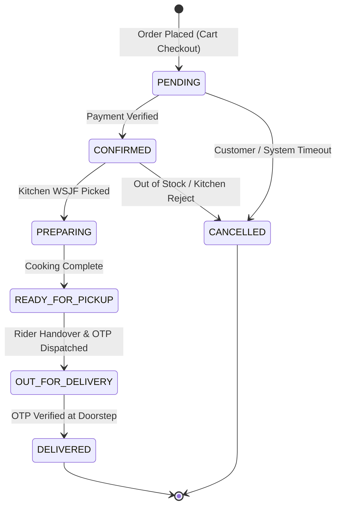

# 🗄️ Relational Data Dictionary & Concurrency Specification (DATA_DICTIONARY.md)

> **Database Engine:** MySQL 8.0 / MariaDB (InnoDB) | **Collation:** `utf8mb4_unicode_ci`  
> **Schema Model:** Third Normal Form (3NF) relational design with ACID triggers and strict foreign key integrity.

---

## 1. Entity Relationship & Core Tables (20 Tables)

### Group A: Identity, Access & Addresses
1. **`roles`**
   - `role_id` (INT, PK, AI)
   - `role_name` (VARCHAR(50), UNIQUE): `'ADMIN'`, `'CUSTOMER'`, `'KITCHEN'`, `'RIDER'`
   - `description` (VARCHAR(255))

2. **`users`**
   - `user_id` (INT, PK, AI)
   - `role_id` (INT, FK -> `roles.role_id`)
   - `full_name` (VARCHAR(120)), `email` (VARCHAR(150), UNIQUE), `phone_number` (VARCHAR(20), UNIQUE)
   - `password_hash` (VARCHAR(255)) — Argon2id or Bcrypt
   - `is_active` (TINYINT(1), Default 1), `created_at` (TIMESTAMP)

3. **`user_addresses`**
   - `address_id` (INT, PK, AI)
   - `user_id` (INT, FK -> `users.user_id` ON DELETE CASCADE)
   - `address_type` (ENUM('HOME', 'WORK', 'OTHER'))
   - `address_line` (TEXT), `landmark` (VARCHAR(150)), `pincode` (VARCHAR(10)), `is_default` (TINYINT(1))

---

### Group B: Menu Catalog & Customizations
4. **`categories`**
   - `category_id` (INT, PK, AI), `category_name` (VARCHAR(100), UNIQUE), `category_slug` (VARCHAR(100), UNIQUE)
   - `category_description` (TEXT), `image_url` (VARCHAR(255)), `display_order` (INT), `is_active` (TINYINT(1))

5. **`menu_items`**
   - `item_id` (INT, PK, AI)
   - `category_id` (INT, FK -> `categories.category_id`)
   - `item_name` (VARCHAR(150)), `description` (TEXT)
   - `price` (DECIMAL(10,2), CHECK > 0), `stock_quantity` (INT, Default 50)
   - `rating` (DECIMAL(3,1)), `total_reviews` (INT)
   - `is_available` (TINYINT(1)), `is_veg` (TINYINT(1)), `is_healthy` (TINYINT(1))
   - `mood` (VARCHAR(100), e.g., 'comfort', 'party', 'focus')
   - `prep_time_minutes` (INT, Default 20), `kitchen_station` (VARCHAR(50))
   - `image_url` (VARCHAR(500)), `created_at` (TIMESTAMP)

6. **`dish_customization_groups`**
   - `group_id` (INT, PK, AI), `item_id` (INT, FK -> `menu_items.item_id` ON DELETE CASCADE)
   - `group_name` (VARCHAR(100)), `min_selection` (INT), `max_selection` (INT), `is_required` (TINYINT(1))

7. **`dish_customization_options`**
   - `option_id` (INT, PK, AI), `group_id` (INT, FK -> `dish_customization_groups.group_id` ON DELETE CASCADE)
   - `option_name` (VARCHAR(100)), `additional_price` (DECIMAL(10,2)), `is_default` (TINYINT(1)), `is_available` (TINYINT(1))

---

### Group C: Order Lifecycle & Fulfillment
8. **`orders`**
   - `order_id` (INT, PK, AI)
   - `customer_id` (INT, FK -> `users.user_id`)
   - `address_id` (INT, FK -> `user_addresses.address_id`)
   - `order_status` (ENUM: `'PENDING'`, `'CONFIRMED'`, `'PREPARING'`, `'READY_FOR_PICKUP'`, `'OUT_FOR_DELIVERY'`, `'DELIVERED'`, `'CANCELLED'`)
   - `total_amount` (DECIMAL(10,2)), `discount_amount` (DECIMAL(10,2)), `delivery_fee` (DECIMAL(10,2)), `tax_amount` (DECIMAL(10,2)), `net_payable` (DECIMAL(10,2))
   - `payment_status` (ENUM: `'UNPAID'`, `'PAID'`, `'REFUNDED'`), `payment_method` (VARCHAR(50))
   - `special_instructions` (TEXT), `delivery_otp` (VARCHAR(6)), `scheduled_delivery_time` (DATETIME NULL)
   - `created_at` (TIMESTAMP), `updated_at` (TIMESTAMP)

9. **`order_items`**
   - `order_item_id` (INT, PK, AI), `order_id` (INT, FK -> `orders.order_id` ON DELETE CASCADE), `item_id` (INT, FK -> `menu_items.item_id`)
   - `quantity` (INT), `unit_price` (DECIMAL(10,2)), `subtotal` (DECIMAL(10,2)), `customizations_json` (JSON / TEXT)

10. **`payments`**
    - `payment_id` (INT, PK, AI), `order_id` (INT, FK -> `orders.order_id`)
    - `transaction_ref` (VARCHAR(100), UNIQUE), `payment_gateway` (VARCHAR(50)), `amount` (DECIMAL(10,2)), `payment_status` (VARCHAR(50))

11. **`delivery_dispatches`**
    - `dispatch_id` (INT, PK, AI), `order_id` (INT, FK -> `orders.order_id`), `rider_id` (INT, FK -> `users.user_id`)
    - `dispatch_status` (ENUM: `'ASSIGNED'`, `'ACCEPTED'`, `'AT_RESTAURANT'`, `'PICKED_UP'`, `'DELIVERED'`, `'FAILED'`)
    - `rider_latitude` (DECIMAL(10,8)), `rider_longitude` (DECIMAL(11,8)), `assigned_at` (TIMESTAMP), `delivered_at` (TIMESTAMP NULL)

12. **`order_audit_trail`**
    - `audit_id` (INT, PK, AI), `order_id` (INT, FK -> `orders.order_id`)
    - `from_status` (VARCHAR(50)), `to_status` (VARCHAR(50)), `changed_by_user_id` (INT, FK -> `users.user_id`), `notes` (TEXT), `timestamp` (TIMESTAMP)

---

### Group D: Feedback, Support & Operations
13. **`order_reviews`** (`review_id`, `order_id`, `customer_id`, `rating`, `comments`, `created_at`)
14. **`dish_reviews`** (`dish_review_id`, `item_id`, `customer_id`, `rating`, `comment`, `is_approved`, `created_at`)
15. **`faqs`** (`faq_id`, `question`, `answer`, `category`, `display_order`, `is_published`)
16. **`support_tickets`** (`ticket_id`, `user_id`, `order_id`, `subject`, `message`, `priority`, `status`, `created_at`, `resolved_at`)
17. **`staff_profiles`** (`staff_id`, `user_id`, `employee_code`, `designation`, `base_salary`, `joined_date`, `bank_details`)
18. **`staff_salary_payouts`** (`payout_id`, `staff_id`, `amount`, `payout_month`, `payout_year`, `status`, `payment_date`)
19. **`money_transactions`** (`transaction_id`, `transaction_type` ENUM('INFLOW','OUTFLOW'), `category`, `amount`, `payment_mode`, `reference_id`, `recorded_by`, `notes`, `transaction_date`)
20. **`cash_register_closures`** (`closure_id`, `closure_date`, `opening_cash`, `cash_sales`, `online_sales`, `closing_cash`, `cash_discrepancy`, `closed_by_staff_id`, `notes`)

---

## 2. Status Progression & State Machine



---

## 3. Concurrency & Locking Protocols

1. **Cart Checkout / Inventory Reduction:**
   - Always run `SELECT stock_quantity FROM menu_items WHERE item_id = ? FOR UPDATE;`
   - If `stock_quantity >= requested_quantity`, decrement and commit. Otherwise rollback and surface an out-of-stock toast.
2. **Delivery Rider Allocation (FCFS Queue):**
   - To prevent multiple riders claiming the same delivery order, lock the `delivery_dispatches` or `orders` row with:
     ```sql
     SELECT order_id FROM orders WHERE order_id = ? AND order_status = 'READY_FOR_PICKUP' FOR UPDATE;
     ```
   - Transition to `OUT_FOR_DELIVERY` and associate `rider_id` within the same transaction.
