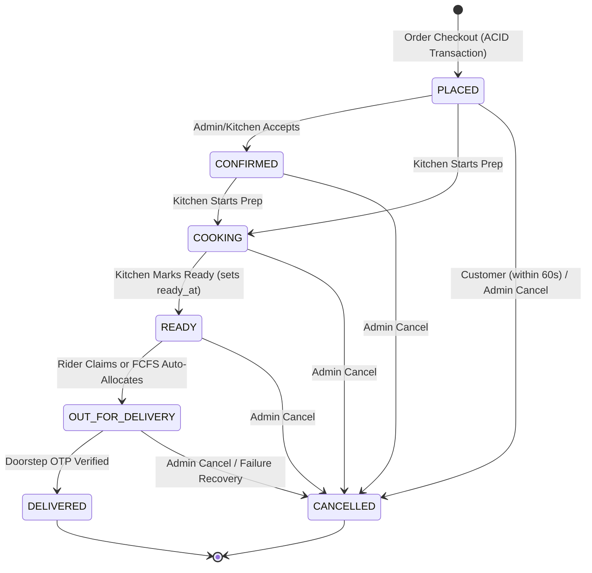

# Zippy — Data Dictionary & Schema Reference

**Database Engine:** MySQL 8.0 / MariaDB (InnoDB)
**Character Set:** `utf8mb4_unicode_ci`
**Schema Sources:** `database/schema.sql` (27 core tables) + `database/migrate_food_moods_table.php` (`food_moods`) = **28 Tables** (with idempotent migration via `database/migrate_v2_features.php`)
**Soft-Delete Policy (`is_active = 1 / 0`):** Enforced on `users`, `user_addresses`, `categories`, `menu_items`, `dish_customization_groups`, `dish_customization_options`, `faqs`, `food_moods`, and `coupons` (see `database/migrate_soft_deletes.php`).

---

## 1. Core Relational Schema (3NF)

### 1.1 Identity & Access Management

#### `roles`
| Column | Type / Constraints | Description |
| :--- | :--- | :--- |
| `role_id` | `INT AUTO_INCREMENT PRIMARY KEY` | Role PK (`1=ADMIN`, `2=CUSTOMER`, `3=KITCHEN`, `4=RIDER`) |
| `role_name` | `VARCHAR(50) NOT NULL UNIQUE` | Canonical uppercase role identifier |
| `description` | `VARCHAR(255) NULL` | Role permissions summary |

#### `users`
| Column | Type / Constraints | Description |
| :--- | :--- | :--- |
| `user_id` | `INT AUTO_INCREMENT PRIMARY KEY` | Unique user account ID |
| `role_id` | `INT NOT NULL DEFAULT 2` (FK -> `roles.role_id`) | Assigned portal role |
| `full_name` | `VARCHAR(120) NOT NULL` | Display name |
| `email` | `VARCHAR(150) NOT NULL UNIQUE` | Login credential |
| `phone_number` | `VARCHAR(20) NOT NULL UNIQUE` | Mobile contact |
| `password_hash` | `VARCHAR(255) NOT NULL` | Bcrypt/Argon2id hash (`password_hash()`) |
| `security_question` | `VARCHAR(255) NULL DEFAULT NULL` | Password recovery prompt |
| `security_answer_hash` | `VARCHAR(255) NULL DEFAULT NULL` | Normalized security answer hash |
| `loyalty_points` | `INT NOT NULL DEFAULT 0` | Current redeemable customer loyalty points balance (`1 pt = ₹1`) |
| `dietary_preferences` | `VARCHAR(255) NULL DEFAULT NULL` | Comma-separated preference keys (`veg_only`, `high_protein`, `dairy_free`, etc.) |
| `is_active` | `TINYINT(1) NOT NULL DEFAULT 1` | Account active flag (`0 = suspended/soft-archived`) |
| `created_at` | `TIMESTAMP NOT NULL DEFAULT CURRENT_TIMESTAMP` | Registration timestamp |

#### `user_addresses`
| Column | Type / Constraints | Description |
| :--- | :--- | :--- |
| `address_id` | `INT AUTO_INCREMENT PRIMARY KEY` | Address PK |
| `user_id` | `INT NOT NULL` (FK -> `users.user_id`) | Owner customer account |
| `address_type` | `ENUM('HOME', 'WORK', 'OTHER') NOT NULL DEFAULT 'HOME'` | Address label |
| `address_line` | `TEXT NOT NULL` | Full delivery street/building address |
| `landmark` | `VARCHAR(150) NULL` | Nearby landmark |
| `pincode` | `VARCHAR(10) NOT NULL` | Bengaluru postal code (`560xxx`) |
| `latitude` / `longitude` | `DECIMAL(10,8)` / `DECIMAL(11,8) NULL` | Pinned customer map coordinates (India/Bengaluru) |
| `distance_km` | `DECIMAL(5,2) NULL DEFAULT NULL` | Haversine distance from Indiranagar Kitchen Hub |
| `is_default` | `TINYINT(1) NOT NULL DEFAULT 0` | Default checkout address flag |
| `is_active` | `TINYINT(1) NOT NULL DEFAULT 1` | Soft-delete flag (`0 = archived`) |

---

### 1.2 Menu Catalog, Customizations & Moods

#### `categories`
| Column | Type / Constraints | Description |
| :--- | :--- | :--- |
| `category_id` | `INT AUTO_INCREMENT PRIMARY KEY` | Category PK |
| `category_name` | `VARCHAR(100) NOT NULL UNIQUE` | Display category title |
| `category_description` | `TEXT NULL` | Category subtitle/notes |
| `category_slug` | `VARCHAR(100) NOT NULL UNIQUE` | URL-safe slug |
| `image_url` | `VARCHAR(255) NULL` | Category artwork path |
| `display_order` | `INT NOT NULL DEFAULT 0` | Sort rank |
| `is_active` | `TINYINT(1) NOT NULL DEFAULT 1` | Soft-delete visibility toggle |

#### `menu_items`
| Column | Type / Constraints | Description |
| :--- | :--- | :--- |
| `item_id` | `INT AUTO_INCREMENT PRIMARY KEY` | Dish PK |
| `category_id` | `INT NOT NULL` (FK -> `categories.category_id`) | Linked category |
| `item_name` | `VARCHAR(150) NOT NULL` | Dish name |
| `description` | `TEXT NULL` | Culinary description |
| `price` | `DECIMAL(10,2) NOT NULL CHECK (price > 0)` | Unit price (INR) |
| `stock_quantity` | `INT NOT NULL DEFAULT 50` | Remaining kitchen inventory (monitored by `trg_after_menu_stock_update`) |
| `rating` | `DECIMAL(3,1) NOT NULL DEFAULT 4.5` | Aggregate rating |
| `total_reviews` | `INT NOT NULL DEFAULT 120` | Review counter |
| `is_available` | `TINYINT(1) NOT NULL DEFAULT 1` | Kitchen stock toggle (`1 = In Stock`) |
| `is_active` | `TINYINT(1) NOT NULL DEFAULT 1` | Catalog soft-delete flag (`0 = Archived`) |
| `is_veg` | `TINYINT(1) NOT NULL DEFAULT 1` | `1 = Vegetarian`, `0 = Non-Veg` |
| `is_healthy` | `TINYINT(1) NOT NULL DEFAULT 0` | `1 = Healthy/Fit choice` |
| `mood` | `VARCHAR(100) NOT NULL DEFAULT 'comfort'` | Comma-separated / keyed mood assignment |
| `prep_time_minutes` | `INT NOT NULL DEFAULT 20` | Estimated prep time for WSJF duration calculation |
| `kitchen_station` | `VARCHAR(50) NOT NULL DEFAULT 'Main Kitchen'` | Assigned station |
| `calories_kcal` | `INT NULL DEFAULT NULL` | Energy content per serving (kcal) |
| `protein_g` / `carbs_g` / `fat_g` | `DECIMAL(5,1) NULL DEFAULT NULL` | Macronutrient breakdown in grams |
| `allergens` | `VARCHAR(255) NULL DEFAULT NULL` | Comma-separated allergen tags (`dairy`, `nuts`, `gluten`, `egg`, `soy`) |
| `spice_level` | `ENUM('MILD', 'MEDIUM', 'SPICY', 'EXTRA_SPICY') NOT NULL DEFAULT 'MEDIUM'` | Dish spice intensity |
| `image_url` | `VARCHAR(500) NULL` | Dish photo path/URL |
| `created_at` | `TIMESTAMP NOT NULL DEFAULT CURRENT_TIMESTAMP` | Creation timestamp |

#### `dish_customization_groups`
| Column | Type / Constraints | Description |
| :--- | :--- | :--- |
| `group_id` | `INT AUTO_INCREMENT PRIMARY KEY` | Customization group PK (`idx_cust_item(item_id)`) |
| `item_id` | `INT NOT NULL` (FK -> `menu_items.item_id`) | Target dish |
| `group_name` | `VARCHAR(100) NOT NULL` | e.g., `"Spice Level"`, `"Extra Add-ons"` |
| `selection_type` | `ENUM('radio', 'checkbox') NOT NULL DEFAULT 'checkbox'` | Single vs multi-select input |
| `is_required` | `TINYINT(1) NOT NULL DEFAULT 0` | Whether customer selection is mandatory |
| `min_selection` | `INT NOT NULL DEFAULT 0` | Minimum allowed options |
| `max_selection` | `INT NOT NULL DEFAULT 0` | Maximum allowed options (`0 = unlimited`) |
| `display_order` | `INT NOT NULL DEFAULT 1` | Render order |
| `is_active` | `TINYINT(1) NOT NULL DEFAULT 1` | Soft-delete flag |
| `created_at` | `TIMESTAMP NOT NULL DEFAULT CURRENT_TIMESTAMP` | Creation timestamp |

#### `dish_customization_options`
| Column | Type / Constraints | Description |
| :--- | :--- | :--- |
| `option_id` | `INT AUTO_INCREMENT PRIMARY KEY` | Option PK (`idx_cust_group(group_id)`) |
| `group_id` | `INT NOT NULL` (FK -> `dish_customization_groups.group_id`) | Parent group |
| `option_name` | `VARCHAR(150) NOT NULL` | Option label (e.g., `"Extra Cheese"`) |
| `price` | `DECIMAL(10,2) NOT NULL DEFAULT 0.00` | Additional unit surcharge per dish quantity |
| `is_default` | `TINYINT(1) NOT NULL DEFAULT 0` | Pre-selected default option |
| `is_available` | `TINYINT(1) NOT NULL DEFAULT 1` | Temporary availability toggle |
| `is_active` | `TINYINT(1) NOT NULL DEFAULT 1` | Soft-delete flag |
| `display_order` | `INT NOT NULL DEFAULT 1` | Render order |
| `created_at` | `TIMESTAMP NOT NULL DEFAULT CURRENT_TIMESTAMP` | Creation timestamp |

#### `food_moods` *(defined in `database/migrate_food_moods_table.php`)*
| Column | Type / Constraints | Description |
| :--- | :--- | :--- |
| `mood_id` | `INT AUTO_INCREMENT PRIMARY KEY` | Mood PK |
| `mood_key` | `VARCHAR(50) NOT NULL UNIQUE` | Identifier referenced by `menu_items.mood` |
| `name` | `VARCHAR(100) NOT NULL` | Full display mood title |
| `short_name` | `VARCHAR(50) NOT NULL` | Compact chip label |
| `emoji` | `VARCHAR(20) NOT NULL DEFAULT '🍽️'` | Mood emoji |
| `icon` | `VARCHAR(50) NOT NULL DEFAULT 'fa-solid fa-utensils'` | Icon class |
| `image_url` | `VARCHAR(255) NOT NULL DEFAULT ''` | Artwork URL/path |
| `tagline` | `VARCHAR(255) NOT NULL DEFAULT ''` | Mood description |
| `badge_bg` / `badge_color` / `border_color` / `accent` | `VARCHAR(20) NOT NULL` | Theme hex colors |
| `display_order` | `INT NOT NULL DEFAULT 0` | Display rank |
| `is_active` | `TINYINT(1) NOT NULL DEFAULT 1` | Active mood flag |
| `created_at` / `updated_at` | `TIMESTAMP DEFAULT CURRENT_TIMESTAMP` | Timestamps |

---

### 1.3 Orders, Payments, Dispatch & Audit Trail

#### `orders`
| Column | Type / Constraints | Description |
| :--- | :--- | :--- |
| `order_id` | `INT AUTO_INCREMENT PRIMARY KEY` | Primary transaction ID |
| `order_number` | `VARCHAR(50) NULL UNIQUE` | External display number (e.g., `ZIP-2026-1001`) |
| `user_id` | `INT NOT NULL` (FK -> `users.user_id`) | Customer account ID |
| `address_id` | `INT NULL` (FK -> `user_addresses.address_id`) | Selected delivery address |
| `subtotal` | `DECIMAL(10,2) NOT NULL DEFAULT 0.00` | Pre-tax cart + customization total |
| `tax_amount` | `DECIMAL(10,2) NOT NULL DEFAULT 0.00` | Calculated GST/tax amount |
| `delivery_fee` | `DECIMAL(10,2) NOT NULL DEFAULT 0.00` | Delivery charge |
| `platform_fee` | `DECIMAL(10,2) NOT NULL DEFAULT 5.00` | Fixed platform convenience charge |
| `discount_amount` | `DECIMAL(10,2) NOT NULL DEFAULT 0.00` | Applied coupon discount |
| `loyalty_points_used` | `INT NOT NULL DEFAULT 0` | Loyalty points redeemed at checkout |
| `loyalty_discount` | `DECIMAL(10,2) NOT NULL DEFAULT 0.00` | INR value redeemed via loyalty points |
| `distance_km` | `DECIMAL(5,2) NULL DEFAULT NULL` | Customer delivery distance snapshot (km) |
| `total_amount` | `DECIMAL(10,2) NOT NULL DEFAULT 0.00` | Grand payable total |
| `coupon_code` | `VARCHAR(50) NULL` | Applied promo code |
| `order_status` | `ENUM('PLACED', 'CONFIRMED', 'COOKING', 'READY', 'OUT_FOR_DELIVERY', 'DELIVERED', 'CANCELLED') NOT NULL DEFAULT 'PLACED'` | Order lifecycle state |
| `ready_at` | `TIMESTAMP NULL DEFAULT NULL` | Kitchen completion timestamp used for FCFS dispatch sorting |
| `is_scheduled` | `TINYINT(1) NOT NULL DEFAULT 0` | `1 = Advance Scheduled Order` |
| `scheduled_for` | `DATETIME NULL DEFAULT NULL` | Target scheduled delivery timestamp (`idx_orders_scheduled`) |
| `scheduled_slot` | `VARCHAR(100) NULL DEFAULT NULL` | Display slot label |
| `order_notes` | `TEXT NULL` | Customer cooking/delivery instructions |
| `placed_at` | `TIMESTAMP NOT NULL DEFAULT CURRENT_TIMESTAMP` | Placement timestamp (enforces 60s self-cancel window) |
| `estimated_delivery_time` | `TIMESTAMP NULL` | Calculated ETA timestamp |

#### `order_items`
| Column | Type / Constraints | Description |
| :--- | :--- | :--- |
| `order_item_id` | `INT AUTO_INCREMENT PRIMARY KEY` | Order line PK |
| `order_id` | `INT NOT NULL` (FK -> `orders.order_id`) | Parent order |
| `item_id` | `INT NOT NULL` (FK -> `menu_items.item_id`) | Purchased dish |
| `quantity` | `INT NOT NULL DEFAULT 1 CHECK (quantity > 0)` | Item count |
| `unit_price` | `DECIMAL(10,2) NOT NULL` | Snapshotted dish unit price |
| `line_total` | `DECIMAL(10,2) NOT NULL` | Total line amount (`(unit_price + customization_unit_total) * quantity`) |
| `customizations` | `TEXT NULL` | JSON snapshot of selected customization groups/options |
| `customization_total` | `DECIMAL(10,2) NOT NULL DEFAULT 0.00` | Total customization surcharge for the line |
| `is_prepped` | `TINYINT(1) NOT NULL DEFAULT 0` | Dish-level KDS prep checklist completion flag |
| `prepped_at` | `TIMESTAMP NULL DEFAULT NULL` | Timestamp when marked prepped on KDS |

#### `payments`
| Column | Type / Constraints | Description |
| :--- | :--- | :--- |
| `payment_id` | `INT AUTO_INCREMENT PRIMARY KEY` | Payment record PK |
| `order_id` | `INT NOT NULL UNIQUE` (FK -> `orders.order_id`) | 1-to-1 order payment link |
| `payment_mode` | `ENUM('UPI', 'CREDIT_CARD', 'DEBIT_CARD', 'NET_BANKING', 'COD') NOT NULL DEFAULT 'COD'` | Checkout payment mode |
| `transaction_reference` | `VARCHAR(100) NOT NULL UNIQUE` | Gateway/COD reference ID |
| `amount_paid` | `DECIMAL(10,2) NOT NULL` | Paid/due amount |
| `payment_status` | `ENUM('PENDING', 'SUCCESSFUL', 'FAILED', 'REFUNDED') NOT NULL DEFAULT 'PENDING'` | Settlement state |
| `payment_timestamp` | `TIMESTAMP NOT NULL DEFAULT CURRENT_TIMESTAMP` | Payment timestamp |

#### `delivery_dispatches`
| Column | Type / Constraints | Description |
| :--- | :--- | :--- |
| `dispatch_id` | `INT AUTO_INCREMENT PRIMARY KEY` | Dispatch PK |
| `order_id` | `INT NOT NULL UNIQUE` (FK -> `orders.order_id`) | Dispatched order |
| `rider_id` | `INT NULL` | Assigned rider `users.user_id` |
| `delivery_partner_name` | `VARCHAR(120) NOT NULL DEFAULT 'Zippy Express Rider'` | Rider display name |
| `delivery_partner_phone` | `VARCHAR(20) NOT NULL DEFAULT '+91 98765 43210'` | Rider contact number |
| `delivery_otp` | `VARCHAR(6) NOT NULL` | 6-digit / 4-digit OTP verified at doorstep |
| `current_latitude` / `current_longitude` | `DECIMAL(10,8)` / `DECIMAL(11,8)` | Live GPS coordinates |
| `delivery_latitude` / `delivery_longitude` | `DECIMAL(10,8)` / `DECIMAL(11,8)` | Customer destination coordinates |
| `route_progress` | `INT NOT NULL DEFAULT 0` | Progress percentage (`0`–`100`) |
| `distance_remaining_km` | `DECIMAL(5,2) NOT NULL DEFAULT 2.40` | Remaining km estimate |
| `estimated_minutes_remaining` | `INT NOT NULL DEFAULT 15` | Live ETA minutes |
| `assigned_at` | `TIMESTAMP NOT NULL DEFAULT CURRENT_TIMESTAMP` | Dispatch claim timestamp |
| `dispatched_at` / `delivered_at` | `TIMESTAMP NULL` | Lifecycle timestamps |
| `delivery_status` | `ENUM('ASSIGNED', 'PICKED_UP', 'IN_TRANSIT', 'DELIVERED', 'FAILED') NOT NULL DEFAULT 'ASSIGNED'` | Dispatch progress status |
| `failure_reason` | `VARCHAR(255) NULL DEFAULT NULL` | Rider SOS exception category |
| `issue_notes` | `TEXT NULL DEFAULT NULL` | Optional rider SOS notes |
| `failed_at` | `TIMESTAMP NULL DEFAULT NULL` | Timestamp when SOS failure was logged |

#### `order_audit_trail`
| Column | Type / Constraints | Description |
| :--- | :--- | :--- |
| `audit_id` | `INT AUTO_INCREMENT PRIMARY KEY` | Immutable log PK |
| `order_id` | `INT NOT NULL` (FK -> `orders.order_id`) | Target order |
| `old_status` | `VARCHAR(50) NULL` | Previous status (`NULL` or initial state) |
| `new_status` | `VARCHAR(50) NOT NULL` | Transitioned status |
| `updated_by_user_id` | `INT NULL` (FK -> `users.user_id`) | Actor `user_id` (logged directly by PHP `transitionOrderStatus()` / services) |
| `change_timestamp` | `TIMESTAMP NOT NULL DEFAULT CURRENT_TIMESTAMP` | Event timestamp |

---

### 1.4 Reviews, Support & Operations Finance

#### `order_reviews`
| Column | Type / Constraints | Description |
| :--- | :--- | :--- |
| `review_id` | `INT AUTO_INCREMENT PRIMARY KEY` | Review PK |
| `order_id` | `INT NOT NULL UNIQUE` (FK -> `orders.order_id`) | Reviewed order |
| `user_id` | `INT NOT NULL` (FK -> `users.user_id`) | Author customer ID |
| `food_rating` | `INT NOT NULL CHECK (food_rating BETWEEN 1 AND 5)` | Food score (`1`–`5`) |
| `rider_rating` | `INT NOT NULL CHECK (rider_rating BETWEEN 1 AND 5)` | Rider score (`1`–`5`) |
| `rider_tip` | `DECIMAL(10,2) NOT NULL DEFAULT 0.00` | Optional rider gratuity |
| `comments` | `TEXT NULL` | Customer review comments |
| `created_at` | `TIMESTAMP NOT NULL DEFAULT CURRENT_TIMESTAMP` | Submission timestamp |

#### `dish_reviews`
| Column | Type / Constraints | Description |
| :--- | :--- | :--- |
| `dish_review_id` | `INT AUTO_INCREMENT PRIMARY KEY` | Dish review PK |
| `item_id` | `INT NOT NULL` (FK -> `menu_items.item_id`) | Reviewed dish |
| `order_id` | `INT NULL` | Optional originating order |
| `user_id` | `INT NOT NULL` (FK -> `users.user_id`) | Author customer ID |
| `rating` | `INT NOT NULL CHECK (rating BETWEEN 1 AND 5)` | Overall rating |
| `appearance_rating` / `taste_rating` / `portion_rating` / `value_rating` | `TINYINT(1) UNSIGNED NOT NULL DEFAULT 5` | Sub-dimension ratings (`1`–`5`) |
| `review_text` | `TEXT NULL` | Written dish review |
| `tags` | `VARCHAR(255) NULL` | Comma-separated tags |
| `created_at` | `TIMESTAMP NOT NULL DEFAULT CURRENT_TIMESTAMP` | Submission timestamp |

#### `faqs`
| Column | Type / Constraints | Description |
| :--- | :--- | :--- |
| `faq_id` | `INT AUTO_INCREMENT PRIMARY KEY` | FAQ PK |
| `question` | `VARCHAR(255) NOT NULL` | FAQ prompt |
| `answer` | `TEXT NOT NULL` | HTML answer (sanitized via `sanitizeFaqContent()`) |
| `category` | `VARCHAR(50) NOT NULL DEFAULT 'General'` | Topic grouping |
| `display_order` | `INT NOT NULL DEFAULT 0` | Sort position |
| `is_active` | `TINYINT(1) NOT NULL DEFAULT 1` | Soft-delete / publish flag |
| `created_at` | `TIMESTAMP NOT NULL DEFAULT CURRENT_TIMESTAMP` | Creation timestamp |

#### `support_tickets`
| Column | Type / Constraints | Description |
| :--- | :--- | :--- |
| `ticket_id` | `INT AUTO_INCREMENT PRIMARY KEY` | Support ticket PK |
| `user_id` | `INT NULL` (FK -> `users.user_id`) | Submitting customer (`NULL` if guest) |
| `customer_name` | `VARCHAR(120) NOT NULL` | Reporter name |
| `customer_email` | `VARCHAR(150) NOT NULL` | Contact email |
| `subject` | `VARCHAR(200) NOT NULL` | Ticket subject |
| `message` | `TEXT NOT NULL` | Inquiry body |
| `ticket_status` | `ENUM('OPEN', 'IN_PROGRESS', 'RESOLVED', 'CLOSED') NOT NULL DEFAULT 'OPEN'` | Ticket workflow status |
| `assigned_admin_id` | `INT NULL DEFAULT NULL` | Handling administrator `users.user_id` |
| `created_at` / `updated_at` | `TIMESTAMP NOT NULL DEFAULT CURRENT_TIMESTAMP` | Submission & latest reply timestamps |

#### `support_ticket_replies`
| Column | Type / Constraints | Description |
| :--- | :--- | :--- |
| `reply_id` | `INT AUTO_INCREMENT PRIMARY KEY` | Reply PK |
| `ticket_id` | `INT NOT NULL` (FK -> `support_tickets.ticket_id`) | Parent support ticket |
| `user_id` | `INT NULL` (FK -> `users.user_id`) | Author account (`NULL` if detached) |
| `sender_role` | `ENUM('CUSTOMER', 'ADMIN') NOT NULL DEFAULT 'ADMIN'` | Message sender portal role |
| `sender_name` | `VARCHAR(120) NOT NULL` | Display name snapshot |
| `reply_message` | `TEXT NOT NULL` | Reply message body |
| `created_at` | `TIMESTAMP NOT NULL DEFAULT CURRENT_TIMESTAMP` | Reply timestamp |

---

### 1.5 Promotions, FCFS Capacity, Persistence & Loyalty Tables

#### `coupons`
| Column | Type / Constraints | Description |
| :--- | :--- | :--- |
| `coupon_id` | `INT AUTO_INCREMENT PRIMARY KEY` | Coupon PK |
| `code` | `VARCHAR(50) NOT NULL UNIQUE` | Uppercase promo code |
| `title` / `description` | `VARCHAR(120)` / `VARCHAR(255) NOT NULL` | Offer display metadata |
| `discount_type` | `ENUM('percentage', 'flat') NOT NULL DEFAULT 'percentage'` | Calculation mode |
| `discount_value` / `max_discount` / `min_order` | `DECIMAL(10,2) NOT NULL DEFAULT 0.00` | Percentage/rupee value, cap, and minimum subtotal |
| `valid_from` / `valid_until` | `DATETIME NULL DEFAULT NULL` | Active promo date window |
| `usage_limit` / `per_user_limit` / `used_count` | `INT NOT NULL DEFAULT 0` | Global & per-customer redemption quotas |
| `first_order_only` / `is_active` | `TINYINT(1) NOT NULL` | First-order gate (`0/1`) and active soft flag |

#### `coupon_redemptions`
| Column | Type / Constraints | Description |
| :--- | :--- | :--- |
| `redemption_id` | `INT AUTO_INCREMENT PRIMARY KEY` | Redemption ledger PK |
| `coupon_id` / `user_id` / `order_id` | `INT NOT NULL` (FKs -> `coupons`, `users`, `orders`) | Coupon, customer, and checkout order |
| `discount_applied` | `DECIMAL(10,2) NOT NULL DEFAULT 0.00` | Actual discount deducted |
| `redeemed_at` | `TIMESTAMP NOT NULL DEFAULT CURRENT_TIMESTAMP` | Redemption timestamp |

#### `scheduled_slot_caps`
| Column | Type / Constraints | Description |
| :--- | :--- | :--- |
| `slot_key` | `VARCHAR(120) PRIMARY KEY` | Canonical `YYYY-MM-DD|SlotLabel` FCFS lock key |
| `slot_date` | `DATE NOT NULL` | Scheduled delivery date (`idx_slot_date`) |
| `slot_label` | `VARCHAR(100) NOT NULL` | Display meal slot window |
| `max_capacity` / `booked_count` | `INT NOT NULL` | Slot cap (default `5`) and locked FCFS reservation counter |
| `updated_at` | `TIMESTAMP NOT NULL DEFAULT CURRENT_TIMESTAMP` | Last slot counter change |

#### `cart_items`
| Column | Type / Constraints | Description |
| :--- | :--- | :--- |
| `cart_item_id` | `INT AUTO_INCREMENT PRIMARY KEY` | Cart row PK |
| `user_id` / `item_id` | `INT NOT NULL` (FKs -> `users`, `menu_items`) | Customer and catalog dish |
| `cart_key` | `VARCHAR(120) NOT NULL` | Unique per `(user_id, cart_key)` including customizations |
| `quantity` | `INT NOT NULL DEFAULT 1` | Requested quantity |
| `customizations_json` / `customization_text` | `TEXT NULL` / `VARCHAR(500) NULL` | Saved customization add-on state |
| `unit_price` | `DECIMAL(10,2) NOT NULL DEFAULT 0.00` | Dish + add-on unit price |

#### `user_favorites`
| Column | Type / Constraints | Description |
| :--- | :--- | :--- |
| `favorite_id` | `INT AUTO_INCREMENT PRIMARY KEY` | Favorite bookmark PK |
| `user_id` / `item_id` | `INT NOT NULL` (FKs -> `users`, `menu_items`) | Unique pair `(user_id, item_id)` |
| `created_at` | `TIMESTAMP NOT NULL DEFAULT CURRENT_TIMESTAMP` | Bookmark timestamp |

#### `loyalty_transactions`
| Column | Type / Constraints | Description |
| :--- | :--- | :--- |
| `loyalty_txn_id` | `INT AUTO_INCREMENT PRIMARY KEY` | Loyalty audit PK |
| `user_id` / `order_id` | `INT NOT NULL` / `INT NULL` | Linked customer & order |
| `txn_type` | `ENUM('EARNED', 'REDEEMED', 'REFUND_BONUS', 'ADMIN_ADJUST') NOT NULL` | Ledger movement category |
| `points` / `balance_after` | `INT NOT NULL` | Point delta (`+/-`) and resulting balance |
| `description` | `VARCHAR(255) NOT NULL` | Human-readable ledger remark |
| `created_at` | `TIMESTAMP NOT NULL DEFAULT CURRENT_TIMESTAMP` | Transaction timestamp |

#### `staff_profiles`
| Column | Type / Constraints | Description |
| :--- | :--- | :--- |
| `profile_id` | `INT AUTO_INCREMENT PRIMARY KEY` | Staff HR profile PK |
| `user_id` | `INT NOT NULL UNIQUE` (FK -> `users.user_id`) | Linked staff user (`KITCHEN` or `RIDER`) |
| `department` | `ENUM('KITCHEN', 'DELIVERY') NOT NULL` | Operational department |
| `designation` | `VARCHAR(100) NOT NULL` | Role title |
| `specialization` | `VARCHAR(150) NULL` | Kitchen/zone specialty |
| `duty_status` | `ENUM('ON_DUTY', 'ON_BREAK', 'OFF_DUTY', 'ON_LEAVE') NOT NULL DEFAULT 'ON_DUTY'` | Live roster state |
| `shift_timings` | `VARCHAR(50) NOT NULL DEFAULT '09:00 AM - 05:00 PM'` | Scheduled shift |
| `vehicle_details` / `driving_license` | `VARCHAR(100)` / `VARCHAR(50) NULL` | Fleet metadata |
| `base_salary` / `hourly_or_order_rate` | `DECIMAL(10,2)` | Compensation rates |
| `joined_date` | `DATE NOT NULL` | Join date |
| `cod_balance` | `DECIMAL(10,2) NOT NULL DEFAULT 0.00` | Unsettled COD cash held by rider |
| `total_orders_handled` | `INT NOT NULL DEFAULT 0` | Completed order count |
| `rating` | `DECIMAL(3,2) NOT NULL DEFAULT 4.80` | Average rating |

#### `staff_salary_payouts`
| Column | Type / Constraints | Description |
| :--- | :--- | :--- |
| `payout_id` | `INT AUTO_INCREMENT PRIMARY KEY` | Payroll payout PK |
| `user_id` | `INT NOT NULL` (FK -> `users.user_id`) | Recipient staff user |
| `month_year` | `VARCHAR(30) NOT NULL` | Payroll cycle label |
| `base_amount` / `incentives_amount` / `deductions_amount` / `net_paid` | `DECIMAL(10,2) NOT NULL` | Payroll breakdown |
| `payment_mode` | `ENUM('BANK_TRANSFER', 'UPI', 'CASH') NOT NULL DEFAULT 'BANK_TRANSFER'` | Transfer channel |
| `transaction_reference` | `VARCHAR(100) NOT NULL` | Payout reference ID |
| `payout_status` | `ENUM('PAID', 'PENDING', 'PROCESSING') NOT NULL DEFAULT 'PAID'` | Disbursement state |
| `paid_at` | `TIMESTAMP NOT NULL DEFAULT CURRENT_TIMESTAMP` | Payout timestamp |
| `notes` | `TEXT NULL` | Optional remarks |

#### `money_transactions`
| Column | Type / Constraints | Description |
| :--- | :--- | :--- |
| `txn_id` | `INT AUTO_INCREMENT PRIMARY KEY` | Ledger entry PK |
| `txn_number` | `VARCHAR(50) NOT NULL UNIQUE` | Unique ledger voucher code |
| `order_id` | `INT NULL` (FK -> `orders.order_id`) | Linked order (if applicable) |
| `user_id` | `INT NULL` (FK -> `users.user_id`) | Linked user (customer/staff) |
| `txn_category` | `ENUM('CUSTOMER_PAYMENT_ONLINE', 'CUSTOMER_PAYMENT_COD', 'COD_DEPOSIT_STORE', 'CUSTOMER_REFUND', 'STAFF_SALARY_PAYOUT') NOT NULL` | Accounting classification |
| `flow_direction` | `ENUM('INWARD', 'OUTWARD') NOT NULL` | Cashflow direction |
| `payment_method` | `ENUM('UPI', 'CREDIT_CARD', 'DEBIT_CARD', 'NET_BANKING', 'COD_CASH', 'BANK_TRANSFER') NOT NULL` | Instrument used |
| `amount` | `DECIMAL(10,2) NOT NULL` | Transaction value |
| `status` | `ENUM('COMPLETED', 'PENDING', 'SETTLED', 'REFUNDED') NOT NULL DEFAULT 'COMPLETED'` | Ledger settlement status |
| `reference_id` / `handled_by` / `notes` | `VARCHAR(100)` / `VARCHAR(120)` / `TEXT NULL` | Reconciliation metadata |
| `created_at` | `TIMESTAMP NOT NULL DEFAULT CURRENT_TIMESTAMP` | Ledger entry timestamp |

#### `cash_register_closures`
| Column | Type / Constraints | Description |
| :--- | :--- | :--- |
| `closure_id` | `INT AUTO_INCREMENT PRIMARY KEY` | Z-report closure PK |
| `closure_date` | `DATE NOT NULL` | Business date |
| `closing_admin_id` | `INT NULL` | Admin who sealed the drawer |
| `closing_admin_name` | `VARCHAR(120) NOT NULL` | Admin name snapshot |
| `total_orders_count` | `INT NOT NULL DEFAULT 0` | Order volume for day |
| `gross_sales` / `online_payments_total` / `expected_cod_cash` / `actual_physical_cash` / `discrepancy_amount` | `DECIMAL(10,2) NOT NULL DEFAULT 0.00` | Daily reconciliation totals (`discrepancy_amount = actual_physical_cash - expected_cod_cash`) |
| `discrepancy_reason` | `TEXT NULL` | Auditor variance explanation |
| `status` | `ENUM('SEALED', 'OPEN', 'FLAGGED') NOT NULL DEFAULT 'SEALED'` | Drawer lock status |
| `closed_at` | `TIMESTAMP NOT NULL DEFAULT CURRENT_TIMESTAMP` | Closure timestamp |

---

## 2. Valid `orders.order_status` State Machine



---

## 3. ACID Concurrency & Row Locking Requirements

Because **Checkout** (`menu_items.stock_quantity`), **Delivery Dispatch Claiming** (`orders`, `delivery_dispatches`, rider `users`), **Bulk Menu Operations**, and **Cash Drawer Closures** operate concurrently, all mutations run inside `dbTransactional()` with canonical `SELECT ... FOR UPDATE` row locks:

```sql
-- Canonical locking order for KDS / Rider Claim / Checkout
START TRANSACTION;
SELECT * FROM orders WHERE order_id = ? FOR UPDATE;
SELECT * FROM delivery_dispatches WHERE order_id = ? FOR UPDATE;
SELECT * FROM menu_items WHERE item_id IN (?) ORDER BY item_id ASC FOR UPDATE;

-- Single source of truth for order status transitions (PHP transitionOrderStatus)
INSERT INTO order_audit_trail (order_id, old_status, new_status, updated_by_user_id)
VALUES (?, ?, ?, ?);
COMMIT;
```

*(Note: `trg_after_menu_stock_update` remains active on `menu_items`, whereas `trg_after_order_status_update` was retired in `database/migrate_drop_audit_trigger.php` so PHP service transitions are the sole writer to `order_audit_trail` with true actor Attribution.)*
