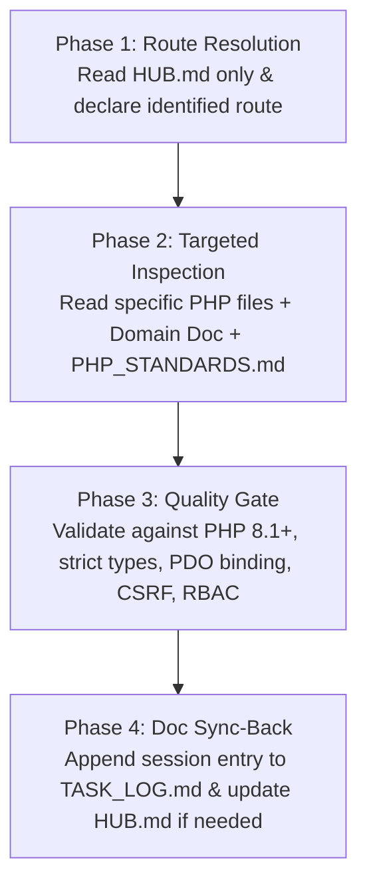

# 🧭 Zippy Master Context Router (HUB.md)

> **Purpose:** Single entry point for AI-assisted problem solving. By referencing this document, the AI deterministically routes to the exact source files, data tables, and architectural rules needed for a task—eliminating broad codebase scans and keeping context token usage minimal (~2k–5k tokens).

---

## 1. System Topology Quick-Map

| Layer / Portal | Directory | Primary Role & Responsibilities | Core Entry File |
| :--- | :--- | :--- | :--- |
| **System Config** | `config/` | App constants, PDO database singleton, session security, CSRF | `config/config.php` |
| **Data & Migrations**| `database/` | 3NF MySQL schema (20 tables), seeders, table migrations | `database/schema.sql` |
| **Shared Engine** | `includes/` | Auth/RBAC, order calculations, computational algorithms | `includes/functions.php` |
| **Customer Portal** | `customer/` | Browsing, cart, checkout, customization, order tracking | `customer/index.php` |
| **Kitchen (KDS)** | `kitchen/` | WSJF queue, prep status, live order polling, KOT | `kitchen/index.php` |
| **Delivery Fleet** | `delivery/` | FCFS dispatch, live GPS telemetry, OTP fulfillment | `delivery/index.php` |
| **Admin Console** | `admin/` | Catalog CRUD, analytics, staff payroll, cash registers, audit | `admin/index.php` |
| **Public API** | `api/` | Webhooks, telemetry, catalog sync, live stream | `api/` |

---

## 2. Problem-to-Resource Routing Matrix

When a problem is presented, locate the matching row below. Load **only** the specified Source Files, Data Tables, and Module Doc:

| Domain / Issue Category | Primary Source Files | Database Tables Involved | Secondary Module Doc |
| :--- | :--- | :--- | :--- |
| **Authentication & RBAC** | `includes/auth.php`<br>`customer/includes/auth_guard.php` | `users`<br>`roles` | [auth_rbac.md](file:///e:/2026%20project/2026%20july/Pooja/pooja_project/docs/modules/auth_rbac.md) |
| **Storefront & Menu Catalog** | `customer/index.php`<br>`customer/restaurant.php`<br>`customer/search.php` | `categories`<br>`menu_items`<br>`dish_customization_*` | [customer_storefront.md](file:///e:/2026%20project/2026%20july/Pooja/pooja_project/docs/modules/customer_storefront.md) |
| **Cart, Checkout & Coupons** | `customer/cart.php`<br>`customer/checkout.php`<br>`includes/functions.php` | `orders`<br>`order_items`<br>`payments`<br>`user_addresses` | [order_lifecycle.md](file:///e:/2026%20project/2026%20july/Pooja/pooja_project/docs/modules/order_lifecycle.md) |
| **Order Lifecycle & Tracking**| `customer/order-status.php`<br>`api/payment-webhook.php`<br>`customer/invoice.php` | `orders`<br>`order_items`<br>`order_audit_trail`<br>`payments` | [order_lifecycle.md](file:///e:/2026%20project/2026%20july/Pooja/pooja_project/docs/modules/order_lifecycle.md) |
| **Kitchen Display (KDS)** | `kitchen/index.php`<br>`kitchen/kot.php`<br>`kitchen/ajax/update-status.php` | `orders`<br>`order_items`<br>`menu_items` | [kitchen_kds.md](file:///e:/2026%20project/2026%20july/Pooja/pooja_project/docs/modules/kitchen_kds.md) |
| **Delivery Fleet & Dispatch** | `delivery/index.php`<br>`api/live-location.php`<br>`includes/FCFSQueue.php` | `delivery_dispatches`<br>`orders`<br>`users` | [delivery_fleet.md](file:///e:/2026%20project/2026%20july/Pooja/pooja_project/docs/modules/delivery_fleet.md) |
| **Algorithms (WSJF, Apriori, SES)** | `includes/AprioriEngine.php`<br>`includes/WSJFQueue.php`<br>`includes/SESDemandForecast.php` | `orders`<br>`order_items`<br>`menu_items` | [computational_algorithms.md](file:///e:/2026%20project/2026%20july/Pooja/pooja_project/docs/modules/computational_algorithms.md) |
| **Admin Operations & Finance**| `admin/dishes.php`<br>`admin/financial-transactions.php`<br>`admin/audit-logs.php` | `money_transactions`<br>`staff_salary_payouts`<br>`cash_register_closures` | [admin_operations.md](file:///e:/2026%20project/2026%20july/Pooja/pooja_project/docs/modules/admin_operations.md) |
| **Database & Schema Setup** | `config/database.php`<br>`database/schema.sql`<br>`database/seed.php` | All 20 tables | [DATA_DICTIONARY.md](file:///e:/2026%20project/2026%20july/Pooja/pooja_project/docs/DATA_DICTIONARY.md) |

---

## 3. Mandatory Governance & Quality Gates

Any code analysis, bugfix, or enhancement proposed by AI MUST comply with:
- **Code Standards & Architecture:** [`PHP_STANDARDS.md`](file:///e:/2026%20project/2026%20july/Pooja/pooja_project/docs/PHP_STANDARDS.md)
- **Data Schema & Locking:** [`DATA_DICTIONARY.md`](file:///e:/2026%20project/2026%20july/Pooja/pooja_project/docs/DATA_DICTIONARY.md)
- **Living Session History:** [`TASK_LOG.md`](file:///e:/2026%20project/2026%20july/Pooja/pooja_project/docs/TASK_LOG.md)

---

## 4. AI Operating Protocol (System Process)

When the user initiates a task with:
```text
Problem: <User problem statement>
Main Doc: HUB.md
```

The AI must follow this strict 4-Phase execution loop:



### Phase 1: Context Routing Statement
The AI begins by stating:
> *"Route Resolved: Domain `[Domain Name]`. Loading `docs/modules/[doc].md`, `docs/PHP_STANDARDS.md`, and source files `[path1]`, `[path2]`. Skipping full-repo scan."*

### Phase 2: Surgical Inspection
Read **only** the target files identified in the matrix. Do not read unrelated portals or large document sets.

### Phase 3: Code Verification Against Standards
Ensure code satisfies:
1. `declare(strict_types=1);` at top of file.
2. Parameter & return type declarations on all functions/methods.
3. Prepared statements with bound parameters (zero raw SQL interpolation).
4. Explicit transaction boundaries (`beginTransaction`, `commit`, `rollBack`) with pessimistic locking for state changes.
5. CSRF token validation and XSS escaping on dynamic output.

### Phase 4: Post-Process Doc Synchronization
Before finishing, the AI must:
1. Append a formatted entry to [`TASK_LOG.md`](file:///e:/2026%20project/2026%20july/Pooja/pooja_project/docs/TASK_LOG.md).
2. If new endpoints, classes, or database tables were introduced, update the routing matrix in [`HUB.md`](file:///e:/2026%20project/2026%20july/Pooja/pooja_project/docs/HUB.md).
