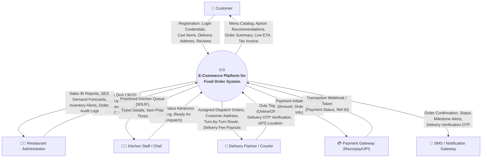
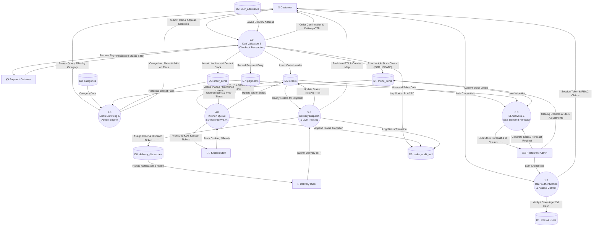
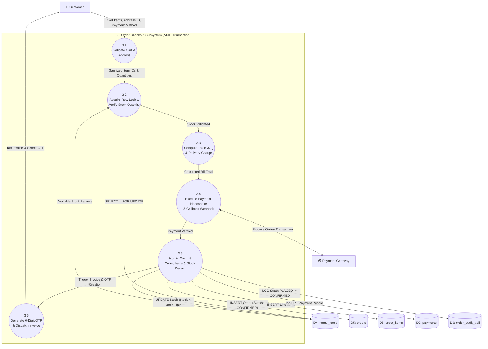
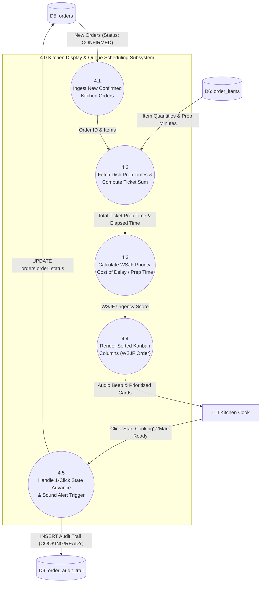
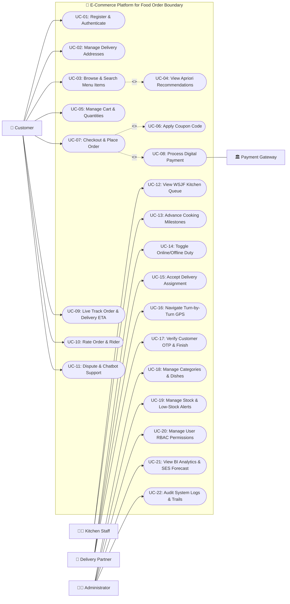
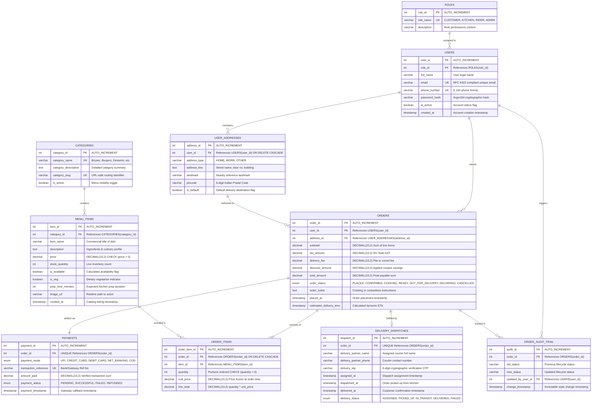

# SYSTEM ANALYSIS & DESIGN SPECIFICATIONS
## E-Commerce Platform for Food Order (MCSP-232)
**Academic Level:** Master of Computer Applications (MCA Major Project)  
**Student:** Pooja JP | **Enrollment No:** 2500051247  
**Institution:** Indira Gandhi National Open University (IGNOU)  

---

## 1. DATA FLOW DIAGRAMS (DFD)

Data Flow Diagrams (DFD) model the flow of data through the system, identifying external entities, data transformation processes, data stores, and directional data pathways.

---

### 1.1 DFD Level 0: Context Diagram
The Level 0 Context Diagram establishes the boundary of the **E-Commerce Food Ordering & Restaurant Management System**, illustrating all external entities and their primary interactions with the centralized system.

---

### 1.2 DFD Level 1: System Decomposition Diagram
The Level 1 DFD decomposes the system into six core functional subsystems and maps their interactions with the **Ten 3NF Data Stores**.

---

### 1.3 DFD Level 2: Critical Subsystem Decompositions

#### A. Level 2 DFD for Process 3.0: Cart Validation & Concurrency-Controlled Checkout
This diagram demonstrates the high-concurrency ACID transactional checkout mechanism, preventing overselling via pessimistic row-level locking.

#### B. Level 2 DFD for Process 4.0: Kitchen Display Scheduling (WSJF Priority Queue)
This diagram illustrates the algorithmic prioritization of kitchen prep tickets based on waiting duration and item preparation times.

---

## 2. USE CASE MODELING

### 2.1 Complete Use Case Diagram
The Use Case diagram depicts four human actors and one external system actor, detailing user goals and dependency relationships (`<<include>>` and `<<extend>>`).

---

### 2.2 Formal Use Case Specifications

#### Use Case 1: UC-07: Checkout & Place Order (with Concurrency Control)
* **Actor:** Registered Customer
* **Pre-conditions:** Customer is authenticated with an active session, has at least one valid item in the cart, and has selected a saved delivery address.
* **Post-conditions:** An immutable order header and line items are committed in MySQL, inventory stock is decremented atomically, payment record is persisted, and a unique 6-digit delivery OTP is generated.
* **Main Success Scenario:**
  1. Customer navigates to checkout, selects the delivery address, and chooses a payment method (UPI / Card / NetBanking / COD).
  2. Customer clicks **"Pay & Place Order"**.
  3. System initiates an atomic database transaction (`START TRANSACTION`).
  4. System acquires row-level pessimistic locks on all cart dishes (`SELECT stock_quantity FROM menu_items WHERE item_id = ? FOR UPDATE`).
  5. System validates that `stock_quantity >= cart_quantity` for every item.
  6. System calculates 5% GST (2.5% CGST + 2.5% SGST), packaging fees, and delivery fee.
  7. System invokes Payment Gateway (UC-08: Razorpay Sandbox Checkout SDK / Offline Test Simulator). Upon payment authorization token return (`pay_...`), system inserts record into `orders` and `order_items`.
  8. System decrements `stock_quantity` by ordered amounts and sets `is_available = FALSE` if stock drops to 0.
  9. System inserts payment details into `payments` table (storing Razorpay payment ID as `transaction_reference` with status `SUCCESSFUL`) and records an initial audit entry in `order_audit_trail`.
  10. System commits transaction (`COMMIT`) and displays animated confirmation with Order ID and Delivery OTP.
* **Alternative / Exception Flows:**
  * *Insufficient Stock:* If any item has fewer portions than requested, the system aborts the transaction (`ROLLBACK`), frees locks, and notifies customer: *"Sorry, [Dish Name] just sold out!"*
  * *Payment Failure:* If the transaction is declined or cancelled, the system logs payment status as `FAILED`, rolls back inventory changes, and allows customer to retry.

---

#### Use Case 2: UC-12: View WSJF Kitchen Queue & Fulfill Orders
* **Actor:** Kitchen Staff / Cook
* **Pre-conditions:** Kitchen staff is authenticated and viewing the Kitchen Display System (KDS) portal.
* **Post-conditions:** Order status advances in the database, order audit trail logs the staff member's ID, and delivery dispatch workflow is triggered when ready.
* **Main Success Scenario:**
  1. KDS interface fetches all active orders in `CONFIRMED` or `COOKING` states via SSE/WebSocket.
  2. For each order, the system computes the Weighted Shortest Job First (WSJF) score:
     $$\text{WSJF Priority} = \frac{\text{Elapsed Waiting Time (mins)} \times \text{Urgency Factor}}{\sum \text{Item Prep Times}}$$
  3. The system sorts tickets dynamically in descending order of WSJF score into Kanban columns: *New Tickets*, *In Kitchen*, and *Ready for Pickup*.
  4. Cook clicks **"Start Cooking"**. System updates `orders.order_status = 'COOKING'` and inserts an audit log entry.
  5. Cook completes preparation, checks off all line items, and clicks **"Order Ready"**.
  6. System plays audio chime, advances status to `'READY'`, and broadcasts a dispatch assignment event to the Delivery Partner pool.

---

#### Use Case 3: UC-17: Verify Customer OTP & Finish Delivery
* **Actor:** Delivery Partner
* **Pre-conditions:** Order status is `'OUT_FOR_DELIVERY'`, courier has reached the customer's delivery address, and customer holds the secret 6-digit OTP.
* **Post-conditions:** Order status transitions to `'DELIVERED'`, delivery timestamp is permanently logged, and rating prompt is pushed to customer.
* **Main Success Scenario:**
  1. Delivery partner arrives at customer location and requests the secret 6-digit verification OTP.
  2. Delivery partner enters OTP into the Delivery Mobile Web App.
  3. Backend verifies that the entered OTP matches `delivery_dispatches.delivery_otp`.
  4. System updates `orders.order_status = 'DELIVERED'` and sets `delivery_dispatches.delivered_at = CURRENT_TIMESTAMP`.
  5. System records audit trail entry and dispatches SMS notification to customer.
  6. Customer application refreshes to prompt for 5-star order and rider rating.
* **Alternative Flow:**
  * *Incorrect OTP:* System alerts courier of incorrect code and limits retry attempts to 3 to prevent brute-force attacks.

---

#### Use Case 4: UC-21: View BI Analytics & SES Demand Forecasting
* **Actor:** Restaurant Administrator
* **Pre-conditions:** Administrator has logged in with Role ID 4 (`ADMIN`).
* **Post-conditions:** System aggregates historical transactional data and renders predictive inventory demand metrics.
* **Main Success Scenario:**
  1. Admin opens the **Executive BI Reports** dashboard.
  2. System executes aggregate SQL queries on `orders` and `order_items` to generate hourly sales distribution, category revenue share, and average prep times.
  3. System executes Single Exponential Smoothing (SES) algorithm across past 30 days of item consumption:
     $$\hat{Y}_{t+1} = \alpha Y_t + (1 - \alpha) \hat{Y}_t \quad (\alpha = 0.3)$$
  4. Dashboard displays forecasted dish quantities for upcoming weekend service and flags items at risk of stockout.
  5. Admin reviews projections and places bulk inventory purchase orders.

---

## 3. ENTITY RELATIONSHIP DIAGRAM (ERD)

### 3.1 3NF Normalized Entity Relationship Diagram
The system schema consists of **10 normalized relational entities** designed to eliminate insertion, update, and deletion anomalies while enforcing strict referential integrity.

---

### 3.2 Database Normalization Analysis (1NF to 3NF)

1. **First Normal Form (1NF) Compliance:**
   - Every column contains atomic (indivisible) values. No comma-delimited strings of ordered items exist in the `orders` table; items are segregated into individual rows in `order_items`.
   - Each table possesses a designated Primary Key (`user_id`, `order_id`, `item_id`, etc.).

2. **Second Normal Form (2NF) Compliance:**
   - The database is in 1NF and satisfies 2NF because all non-key attributes are fully functionally dependent on the entire primary key.
   - In junction table `order_items`, the composite natural key `(order_id, item_id)` maps to surrogate key `order_item_id`. The attribute `unit_price` is captured explicitly to preserve historic point-in-time pricing independent of future menu price fluctuations.

3. **Third Normal Form (3NF) Compliance:**
   - The database is in 2NF and exhibits no transitive dependencies ($X \to Y$ and $Y \to Z$ where $Z$ is non-prime).
   - Customer addresses are extracted out of `users` into `user_addresses`.
   - Category names and metadata are extracted out of `menu_items` into `categories`.
   - Payment and dispatch records are detached from the order header into `payments` and `delivery_dispatches` to prevent null-value anomalies during multi-stage order lifecycles.

---

### 3.3 Physical Implementation Mapping Matrix (Portals & Relational Tables)

| Subsystem / Portal | Physical Implementation Path | Primary Actors | Use Cases Implemented | Underlying 3NF Relational Tables |
| :--- | :--- | :--- | :--- | :--- |
| **Customer Storefront** | [`customer/index.php`](file:///e:/2026%20project/2026%20july/Pooja/pooja_project/customer/index.php) [`customer/checkout.php`](file:///e:/2026%20project/2026%20july/Pooja/pooja_project/customer/checkout.php) [`customer/order-status.php`](file:///e:/2026%20project/2026%20july/Pooja/pooja_project/customer/order-status.php) | Customer (Role 2) | UC-01 to UC-11 | `users`, `user_addresses`, `categories`, `menu_items`, `orders`, `order_items`, `payments`, `delivery_dispatches` |
| **Delivery Partner Fleet Portal (Delivery Boy)** | [`delivery/index.php`](file:///e:/2026%20project/2026%20july/Pooja/pooja_project/delivery/index.php) [`delivery/login.php`](file:///e:/2026%20project/2026%20july/Pooja/pooja_project/delivery/login.php) | Courier Rider (Role 4: Suresh Kumar) | **UC-14** (Duty Toggle) **UC-15** (Claim Dispatch) **UC-16** (Turn-by-Turn GPS) **UC-17** (Doorstep OTP Handshake) | `users`, `orders`, `order_items`, `delivery_dispatches`, `payments`, `order_audit_trail` |
| **Kitchen Display System (KDS)** | [`kitchen/index.php`](file:///e:/2026%20project/2026%20july/Pooja/pooja_project/kitchen/index.php) [`kitchen/login.php`](file:///e:/2026%20project/2026%20july/Pooja/pooja_project/kitchen/login.php) [`kitchen/kot.php`](file:///e:/2026%20project/2026%20july/Pooja/pooja_project/kitchen/kot.php) *(Admin bridge: [`admin/kitchen.php`](file:///e:/2026%20project/2026%20july/Pooja/pooja_project/admin/kitchen.php))* | Kitchen Chef (Role 3: Chef Sanjeev) | **UC-12** (WSJF Prioritized Queue) **UC-13** (Cooking & Ready Milestones) | `orders`, `order_items`, `menu_items`, `order_audit_trail` |
| **Restaurant Admin Console** | [`admin/index.php`](file:///e:/2026%20project/2026%20july/Pooja/pooja_project/admin/index.php) [`admin/orders.php`](file:///e:/2026%20project/2026%20july/Pooja/pooja_project/admin/orders.php) [`admin/reports.php`](file:///e:/2026%20project/2026%20july/Pooja/pooja_project/admin/reports.php) | Administrator (Role 1: Pooja JP) | **UC-18** to **UC-22** (Menu CRUD, SES Demand Forecasting, RBAC) | `roles`, `users`, `categories`, `menu_items`, `orders`, `payments`, `order_audit_trail` |

---

## 4. FUTURE SCOPE & SYSTEM ENHANCEMENTS

To advance the platform from an academic major project into an enterprise-scale commercial ecosystem, the following eight technical enhancement avenues are established:

### 4.1 AI-Powered Conversational Voice Ordering (Multilingual NLP)
* **Architecture:** Integration of Whisper ASR (Automatic Speech Recognition) and fine-tuned open-source LLMs (Llama 3 / Mistral) via WebSocket streaming.
* **Impact:** Enables voice ordering in regional Indian languages (Hindi, Kannada, Malayalam, Tamil) for non-tech-savvy and visually impaired users.
* **Mechanism:** Converts audio streams into structured JSON cart intents (`{"action": "ADD_TO_CART", "item": "Chicken Biryani", "qty": 2, "spice_level": "medium"}`).

### 4.2 Autonomous Drone & Robotic Delivery Fleet Integration
* **Architecture:** Unmanned Aerial Vehicle (UAV) dispatch integration using MAVLink protocols and UTM (Unmanned Traffic Management) APIs.
* **Impact:** Drastically bypasses urban traffic bottlenecks in metropolitan zones, reducing last-mile delivery times from 40 minutes to under 12 minutes for perishable meals.
* **Mechanism:** Automatic calculation of payload weight limits against dish orders and geofenced safe landing waypoint verification.

### 4.3 Dynamic Surge Pricing & Predictive Kitchen Load Balancing
* **Architecture:** Reinforcement learning agent trained on historical weather radar APIs (OpenWeather), live traffic congestion (Google Distance Matrix), and pending kitchen queue depths.
* **Impact:** Prevents kitchen burnout during extreme rain or festival peaks by dynamically adjusting delivery fees and throttling order acceptance windows.

### 4.4 Blockchain-Enabled Farm-to-Fork Food Traceability
* **Architecture:** Hyperledger Fabric private permissioned blockchain recording supplier meat/produce batch certificates and cold-chain temperature telemetry.
* **Impact:** Provides tamper-proof verification of organic claims, Halal certification, and food freshness timestamps accessible to customers via on-box QR code scans.

### 4.5 Multi-Tenant Cloud Kitchen SaaS Architecture
* **Architecture:** Transition from single-restaurant deployment to a multi-tenant microservices model with horizontal pod autoscaling on Kubernetes (EKS/GKE).
* **Impact:** Allows the platform to onboard thousands of independent restaurant brands with isolated tenant databases, custom domains, and automated billing tiers.

### 4.6 IoT Connected Smart Kitchen Appliance Telemetry
* **Architecture:** MQTT broker integration with smart ovens, deep fryers, and digital weight scales.
* **Impact:** Automatically notifies the Kitchen Display System (KDS) when a fryer reaches target temperature or when bulk ingredient containers (rice, oil, flour) drop below reserve thresholds, automatically queuing inventory replenishment orders.

### 4.7 Multi-Drop Fleet Routing via Genetic Algorithms
* **Architecture:** Vehicle Routing Problem with Time Windows (VRPTW) solved using Genetic Algorithms and Ant Colony Optimization.
* **Impact:** Bundles orders from neighboring food outlets destined for adjacent residential apartments to a single rider, slashing fleet fuel consumption and carbon footprint by 35%.

### 4.8 Offline-First Progressive Web App (PWA) with Biometric Passkeys
* **Architecture:** WebAuthn standard with FIDO2 hardware passkeys (fingerprint / FaceID) paired with Service Workers and IndexedDB cache storage.
* **Impact:** Allows users in low-connectivity 2G/3G zones to browse menus and curate offline carts that automatically synchronize when network connectivity resumes.

---
*End of System Analysis & Design Specification (MCSP-232)*
