# SYSTEM ANALYSIS & DESIGN SPECIFICATIONS
## E-Commerce Platform for Food Order (MCSP-232)
**Academic Level:** Master of Computer Applications (MCA Major Project)  
**Student:** Pooja JP | **Enrollment No:** 2500051247  
**Institution:** Indira Gandhi National Open University (IGNOU)  
**Project Repository:** [`pooja_project`](file:///e:/2026%20project/2026%20july/Pooja/pooja_project)

---

## 1. DATA FLOW DIAGRAMS (DFD)

Data Flow Diagrams (DFD) model the flow of data across system boundaries, identifying external entities, data transformation processes, data stores, and directional data pathways across Level 0, Level 1, and Level 2 decompositions.

---

### 1.1 DFD Level 0: Context Diagram
The Level 0 Context Diagram establishes the boundary of the **E-Commerce Food Ordering & Restaurant Management System**, illustrating all external entities and their primary interactions with the centralized system.

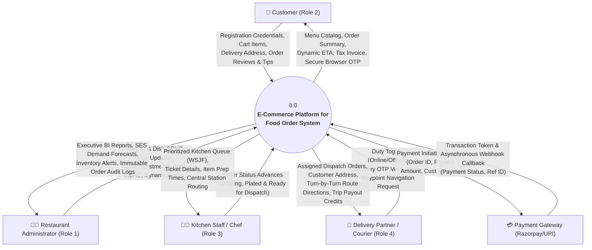

---

### 1.2 DFD Level 1: System Decomposition Diagram
The Level 1 DFD decomposes the system into seven core functional subsystems and maps their data interactions across the **Twelve 3NF Relational Data Stores**.

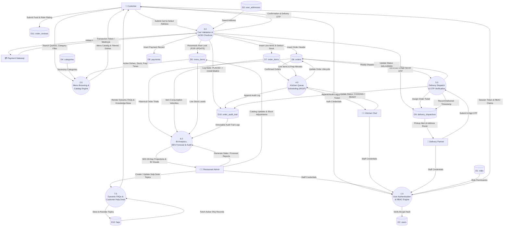

---

### 1.3 DFD Level 2: Subsystem Decompositions

#### A. Level 2 DFD for Process 1.0: User Authentication & Role-Based Access Control
Decomposes session initialization, credential sanitization, cryptographic Bcrypt verification, and role guard enforcement.

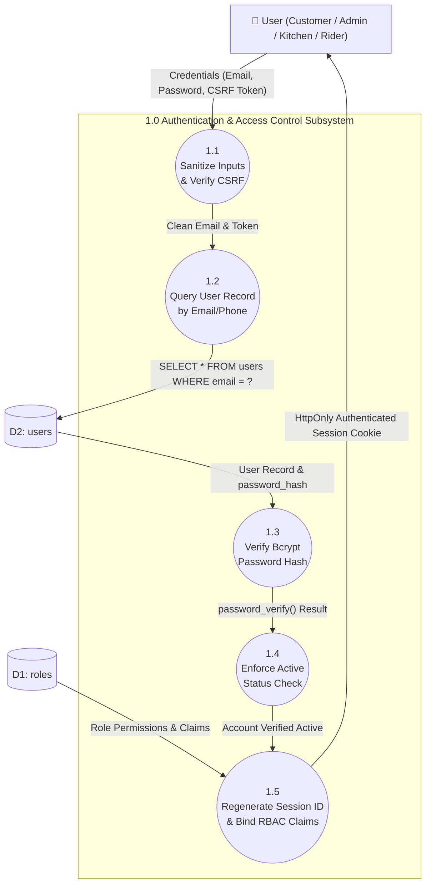

---

#### B. Level 2 DFD for Process 2.0: Menu Catalog Browsing, Search & Dietary Filtering
Decomposes catalog retrieval, keyword search indexing, live inventory availability checks, and dietary classification.

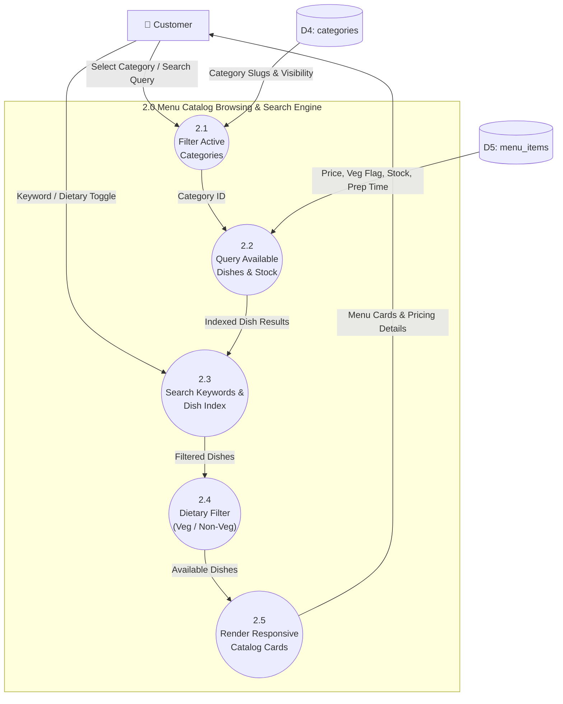

---

#### C. Level 2 DFD for Process 3.0: Cart Validation & Concurrency-Controlled Checkout
Demonstrates the high-concurrency ACID transactional checkout mechanism, preventing overselling via pessimistic row-level locking.

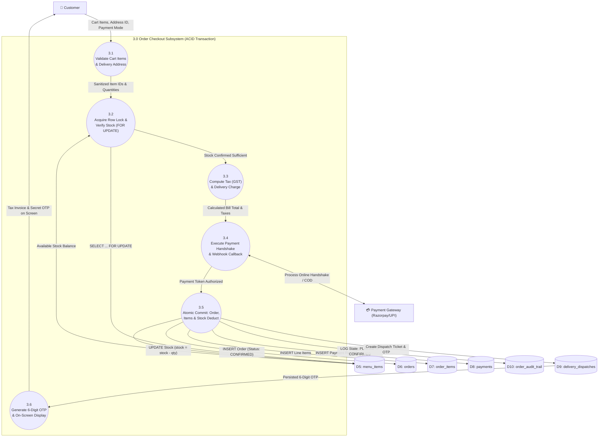

---

#### D. Level 2 DFD for Process 4.0: Kitchen Display Scheduling (WSJF Priority Queue)
Illustrates algorithmic prioritization of kitchen prep tickets based on elapsed waiting duration and dish preparation times.

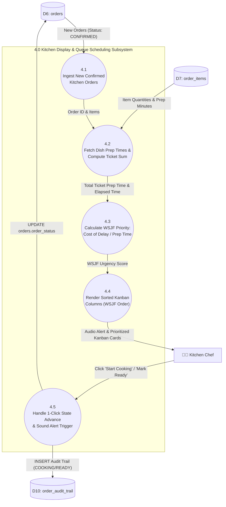

---

#### E. Level 2 DFD for Process 5.0: Delivery Dispatch, Waypoint Routing & OTP Handshake
Illustrates order pickup claiming, simulated turn-by-turn waypoint routing, and cryptographic 6-digit OTP verification at doorstep.

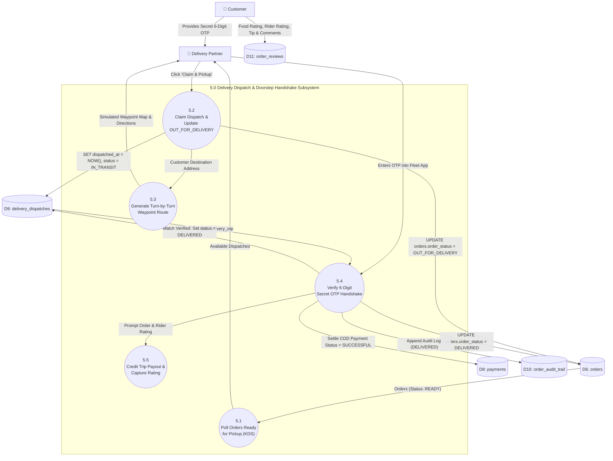

---

#### F. Level 2 DFD for Process 6.0: BI Analytics, SES Demand Forecasting & Audit Logs
Decomposes reporting aggregation, Single Exponential Smoothing (SES) demand projection, and compliance audit trail inspection.

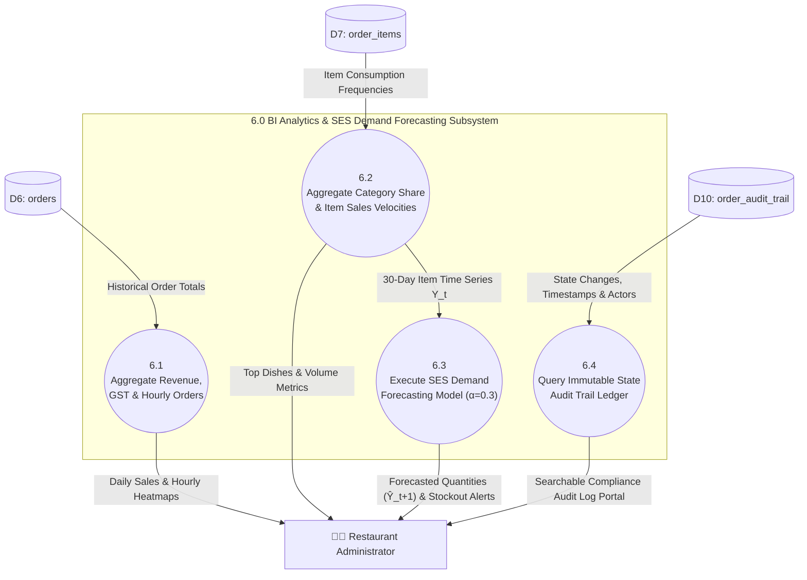

---

## 2. USE CASE MODELING

### 2.1 Complete Use Case Diagram
The Use Case diagram depicts four human actors and one external system actor, detailing user goals and dependency relationships (`<<include>>` and `<<extend>>`).

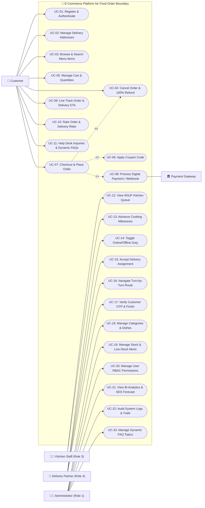

---

### 2.2 Formal Use Case Specifications (Complete 23 Specifications)

| UC ID | Use Case Name | Primary Actor | Pre-Conditions | Post-Conditions | Main Success Flow Summary | Alternative / Exception Flow |
| :--- | :--- | :--- | :--- | :--- | :--- | :--- |
| **UC-01** | Register & Authenticate | All Actors | Valid internet connection, browser session initialized | Session established with role claims | User enters email/phone and password; system validates format, verifies Bcrypt hash, regenerates session ID. | Invalid password prompts retry; deactivated user blocked with message. |
| **UC-02** | Manage Delivery Addresses | Customer | Customer authenticated | Address record saved in `user_addresses` | Customer enters street line, landmark, pincode, type (HOME/WORK), and sets default status. | Incomplete street address triggers validation prompt. |
| **UC-03** | Browse & Search Menu Items | Customer | Storefront loaded | Dishes filtered by keyword/category | Customer types search keyword or clicks category slug; system executes indexed query on `menu_items`. | No matching items renders empty state with recommended alternatives. |
| **UC-04** | Cancel Order & 100% Refund (60s Window) | Customer | Active order placed within $\le 60$ seconds | Order status CANCELLED, payment REFUNDED, inventory restocked | Customer clicks 'Cancel Order' within 60s of placement; system cancels order atomically, refunds 100% of payment, restocks items, and logs audit record. | Cancellation attempt after 60s blocked as kitchen food preparation has locked in. |
| **UC-05** | Manage Cart & Quantities | Customer | Dishes selected | Session cart updated | Customer increments/decrements quantity; live subtotal recalculated via JavaScript and session sync. | Item stock limit reached prevents quantity exceeding available inventory. |
| **UC-06** | Apply Coupon Code | Customer | Cart populated | Discount applied to bill total | Customer enters coupon (e.g. `WELCOME50`); system checks minimum order threshold and computes savings. | Order below minimum spend displays clear requirement message. |
| **UC-07** | Checkout & Place Order | Customer | Cart valid, address chosen | Order committed atomically | System acquires row-level locks (`FOR UPDATE`), checks stock, commits order header and items atomically. | Insufficient stock aborts transaction (`ROLLBACK`) and alerts user. |
| **UC-08** | Process Digital Payment & Webhooks | Customer / Payment GW | Order checkout initiated | Payment persisted with transaction ID | Razorpay sandbox token or COD generated; webhook listener handles status updates atomically. | Declined payment marks transaction `FAILED` and rolls back inventory. |
| **UC-09** | Live Track Order & Dynamic ETA | Customer | Active order placed | Order status & ETA visible | Customer views live milestone bar; periodic REST AJAX poller checks status updates in real time. | Order cancelled renders cancellation banner and refund notice. |
| **UC-10** | Rate Order & Delivery Rider | Customer | Order status is `DELIVERED` | Feedback stored in `order_reviews` | Customer rates food quality (1-5 stars), rider service (1-5 stars), adds tip, and submits comments. | Existing review opens in edit mode; duplicate submission updates record. |
| **UC-11** | Help Desk Inquiries & Dynamic FAQs | Customer | Help page open | Inquiry sent, FAQs viewed | Customer browses accordion topics dynamically retrieved from `faqs` table or submits support ticket. | Database offline falls back gracefully to default built-in FAQ list. |
| **UC-12** | View WSJF Kitchen Queue | Kitchen Chef | Chef logged in (Role 3) | Prioritized tickets rendered | KDS computes WSJF urgency scores and arranges cards in Kanban columns sorted by urgency. | Zero pending orders displays empty queue standby screen. |
| **UC-13** | Advance Cooking Milestones | Kitchen Chef | Ticket active in KDS | Order status transitioned | Chef clicks "Start Cooking" (`COOKING`) or "Order Ready" (`READY`); audit trail logs state change. | Concurrent status change reflects immediately via poller. |
| **UC-14** | Toggle Online/Offline Duty | Delivery Partner | Rider logged in (Role 4) | Duty state saved in session | Rider toggles switch; system updates session flag to accept or pause incoming order dispatches. | Offline rider cannot claim active pickup tickets. |
| **UC-15** | Accept Delivery Assignment | Delivery Partner | Order status is `READY` | Order claimed by rider | Rider clicks "Pick Up"; system sets status to `OUT_FOR_DELIVERY`, assigns rider name, and updates dispatch. | Already-claimed order alerts rider that another partner accepted it. |
| **UC-16** | Navigate Turn-by-Turn Route | Delivery Partner | Order claimed by rider | Route directions displayed | Fleet app opens waypoint map modal with customer address, landmark, and Google Maps direct link. | Invalid address coordinates defaults to pincode center. |
| **UC-17** | Verify Customer OTP & Finish | Delivery Partner | Status is `OUT_FOR_DELIVERY` | Order marked `DELIVERED` | Courier enters 6-digit OTP from customer; backend validates against `delivery_otp` and records delivery time. | Incorrect OTP alerts rider with informative error and blocks fraudulent completion. |
| **UC-18** | Manage Categories & Dishes | Admin | Admin logged in (Role 1) | Menu catalog modified | Admin adds, edits, or deactivates dishes and categories with prices, veg flags, prep times, and photos. | Duplicate category slug triggers validation warning. |
| **UC-19** | Manage Stock & Low-Stock Alerts | Admin | Admin logged in (Role 1) | Inventory quantities updated | Admin adjusts stock quantities; automatic triggers flag dishes with 0 inventory as unavailable. | Negative stock input rejected by validation rules. |
| **UC-20** | Manage User RBAC Permissions | Admin | Admin logged in (Role 1) | User role/status updated | Admin creates staff accounts (Kitchen, Rider, Admin) and toggles active status of existing users. | Self-deactivation by primary admin blocked to prevent lockouts. |
| **UC-21** | View BI Analytics & SES Forecast | Admin | Admin logged in (Role 1) | Charts and predictions rendered | System aggregates revenue, peak hours, category splits, and runs Single Exponential Smoothing ($\alpha=0.3$). | Insufficient historical data switches SES to moving average fallback. |
| **UC-22** | Audit System Logs & Trails | Admin | Admin logged in (Role 1) | Immutable audit log rendered | Admin inspects chronological lifecycle transitions in `admin/audit-logs.php` with actor and timestamp filters. | No search matches displays empty filter message. |
| **UC-23** | Manage Dynamic FAQ Topics | Admin | Admin logged in (Role 1) | Knowledge base updated | Admin adds, edits, reorders, or deletes FAQ topics via `admin/faqs.php` to immediately update storefront. | Missing question or answer prevents form submission. |

---

## 3. ENTITY RELATIONSHIP DIAGRAM & DATA DICTIONARY

### 3.1 3NF Normalized Entity Relationship Diagram (13 Relational Tables)

```mermaid
erDiagram
    ROLES ||--o{ USERS : "assigned to"
    USERS ||--o{ USER_ADDRESSES : "maintains"
    USERS ||--o{ ORDERS : "places"
    USERS ||--o{ ORDER_AUDIT_TRAIL : "triggers"
    USERS ||--o{ ORDER_REVIEWS : "authors"
    USERS ||--o{ SUPPORT_TICKETS : "submits"
    CATEGORIES ||--o{ MENU_ITEMS : "contains"
    USER_ADDRESSES ||--o{ ORDERS : "delivered to"
    ORDERS ||--|{ ORDER_ITEMS : "consists of"
    MENU_ITEMS ||--o{ ORDER_ITEMS : "included in"
    ORDERS ||--|| PAYMENTS : "settled via"
    ORDERS ||--o| DELIVERY_DISPATCHES : "fulfilled by"
    ORDERS ||--o{ ORDER_AUDIT_TRAIL : "tracked in"
    ORDERS ||--o| ORDER_REVIEWS : "reviewed in"

    ROLES {
        int role_id PK "AUTO_INCREMENT"
        varchar role_name UK "ADMIN, CUSTOMER, KITCHEN, RIDER"
        varchar description "Role context"
    }

    USERS {
        int user_id PK "AUTO_INCREMENT"
        int role_id FK "References ROLES(role_id)"
        varchar full_name "Legal name"
        varchar email UK "Unique RFC email"
        varchar phone_number UK "Unique E.164 phone"
        varchar password_hash "Bcrypt hash ($2y$)"
        boolean is_active "Active toggle"
        timestamp created_at "Registration time"
    }

    USER_ADDRESSES {
        int address_id PK "AUTO_INCREMENT"
        int user_id FK "References USERS(user_id) ON DELETE CASCADE"
        enum address_type "HOME, WORK, OTHER"
        text address_line "Street, building, flat"
        varchar landmark "Nearby reference"
        varchar pincode "6-digit postal PIN"
        boolean is_default "Default flag"
    }

    CATEGORIES {
        int category_id PK "AUTO_INCREMENT"
        varchar category_name UK "Taxonomy title"
        text category_description "Category summary"
        varchar category_slug UK "URL routing slug"
        varchar image_url "Category visual banner"
        int display_order "Sorting order"
        boolean is_active "Visibility toggle"
    }

    MENU_ITEMS {
        int item_id PK "AUTO_INCREMENT"
        int category_id FK "References CATEGORIES(category_id)"
        varchar item_name "Commercial dish name"
        text description "Culinary description"
        decimal price "DECIMAL(10,2) CHECK > 0"
        int stock_quantity "Live stock portions"
        boolean is_available "Calculated availability"
        boolean is_veg "Vegetarian indicator"
        int prep_time_minutes "Kitchen prep minutes"
        varchar kitchen_station "Main Kitchen, Tandoor, etc."
        varchar image_url "Dish image asset"
        timestamp created_at "Listing timestamp"
    }

    ORDERS {
        int order_id PK "AUTO_INCREMENT"
        varchar order_number UK "Human-friendly code #ZIP-xxxx"
        int user_id FK "References USERS(user_id)"
        int address_id FK "References USER_ADDRESSES(address_id)"
        decimal subtotal "DECIMAL(10,2)"
        decimal tax_amount "DECIMAL(10,2) 5% GST"
        decimal delivery_fee "DECIMAL(10,2)"
        decimal platform_fee "DECIMAL(10,2) Flat ₹5.00"
        decimal discount_amount "DECIMAL(10,2) Coupon savings"
        decimal total_amount "DECIMAL(10,2) Final payable sum"
        varchar coupon_code "Applied coupon identifier"
        enum order_status "PLACED, CONFIRMED, COOKING, READY, OUT_FOR_DELIVERY, DELIVERED, CANCELLED"
        text order_notes "Cooking / delivery instructions"
        timestamp placed_at "Order placement time"
        timestamp estimated_delivery_time "Dynamic ETA"
    }

    ORDER_ITEMS {
        int order_item_id PK "AUTO_INCREMENT"
        int order_id FK "References ORDERS(order_id) ON DELETE CASCADE"
        int item_id FK "References MENU_ITEMS(item_id)"
        int quantity "CHECK quantity > 0"
        decimal unit_price "Price frozen at order"
        decimal line_total "quantity * unit_price"
    }

    PAYMENTS {
        int payment_id PK "AUTO_INCREMENT"
        int order_id FK "UNIQUE References ORDERS(order_id)"
        enum payment_mode "UPI, CREDIT_CARD, DEBIT_CARD, NET_BANKING, COD"
        varchar transaction_reference UK "Gateway Ref ID"
        decimal amount_paid "DECIMAL(10,2)"
        enum payment_status "PENDING, SUCCESSFUL, FAILED, REFUNDED"
        timestamp payment_timestamp "Payment completion time"
    }

    DELIVERY_DISPATCHES {
        int dispatch_id PK "AUTO_INCREMENT"
        int order_id FK "UNIQUE References ORDERS(order_id)"
        varchar delivery_partner_name "Assigned courier name"
        varchar delivery_partner_phone "Courier phone"
        varchar delivery_otp "6-digit verification code"
        timestamp assigned_at "Dispatch assignment time"
        timestamp dispatched_at "Kitchen pickup time"
        timestamp delivered_at "Customer delivery time"
        enum delivery_status "ASSIGNED, PICKED_UP, IN_TRANSIT, DELIVERED, FAILED"
    }

    ORDER_AUDIT_TRAIL {
        int audit_id PK "AUTO_INCREMENT"
        int order_id FK "References ORDERS(order_id) ON DELETE CASCADE"
        varchar old_status "Previous lifecycle status"
        varchar new_status "Updated lifecycle status"
        int updated_by_user_id FK "References USERS(user_id)"
        timestamp change_timestamp "Immutable change time"
    }

    ORDER_REVIEWS {
        int review_id PK "AUTO_INCREMENT"
        int order_id FK "UNIQUE References ORDERS(order_id) ON DELETE CASCADE"
        int user_id FK "References USERS(user_id)"
        int food_rating "CHECK 1 to 5 stars"
        int rider_rating "CHECK 1 to 5 stars"
        decimal rider_tip "Courier tip amount"
        text comments "Customer review feedback"
        timestamp created_at "Review submission time"
    }

    FAQS {
        int faq_id PK "AUTO_INCREMENT"
        varchar question "Knowledge base question"
        text answer "Detailed HTML explanation"
        varchar category "Knowledge topic classification"
        int display_order "Sorting weight"
        boolean is_active "Storefront visibility toggle"
        timestamp created_at "Creation timestamp"
    }

    SUPPORT_TICKETS {
        int ticket_id PK "AUTO_INCREMENT"
        int user_id FK "References USERS(user_id) ON DELETE SET NULL"
        varchar customer_name "Inquiring customer name"
        varchar customer_email "Contact email address"
        varchar subject "Inquiry subject / category"
        text message "Support inquiry message body"
        enum ticket_status "OPEN, IN_PROGRESS, RESOLVED, CLOSED"
        timestamp created_at "Ticket submission timestamp"
    }
```

---

### 3.2 Formal Data Dictionary (Comprehensive 13 Relational Tables)

#### Table 1: `roles`
| Field Name | Data Type | Nullable | Key / Constraint | Default Value | Description |
| :--- | :--- | :--- | :--- | :--- | :--- |
| `role_id` | INT | NO | PRIMARY KEY, AUTO_INCREMENT | None | Unique numeric role identifier (1=ADMIN, 2=CUSTOMER, 3=KITCHEN, 4=RIDER) |
| `role_name` | VARCHAR(50) | NO | UNIQUE | None | Standardized uppercase role name |
| `description` | VARCHAR(255) | YES | None | NULL | Contextual description of role authorization scope |

#### Table 2: `users`
| Field Name | Data Type | Nullable | Key / Constraint | Default Value | Description |
| :--- | :--- | :--- | :--- | :--- | :--- |
| `user_id` | INT | NO | PRIMARY KEY, AUTO_INCREMENT | None | Unique system user ID |
| `role_id` | INT | NO | FOREIGN KEY $\to$ `roles(role_id)` | 2 | Role reference mapping to authorization claims |
| `full_name` | VARCHAR(120) | NO | None | None | Legal full name of user or staff member |
| `email` | VARCHAR(150) | NO | UNIQUE | None | Primary RFC 5322 compliant email address |
| `phone_number` | VARCHAR(20) | NO | UNIQUE | None | Contact number in E.164 format |
| `password_hash` | VARCHAR(255) | NO | None | None | Cryptographic password hash generated via Bcrypt (`PASSWORD_DEFAULT`) |
| `is_active` | TINYINT(1) | NO | None | 1 | Boolean toggle controlling login privileges (1=Active, 0=Deactivated) |
| `created_at` | TIMESTAMP | NO | None | CURRENT_TIMESTAMP | User account creation timestamp |

#### Table 3: `user_addresses`
| Field Name | Data Type | Nullable | Key / Constraint | Default Value | Description |
| :--- | :--- | :--- | :--- | :--- | :--- |
| `address_id` | INT | NO | PRIMARY KEY, AUTO_INCREMENT | None | Unique delivery address identifier |
| `user_id` | INT | NO | FOREIGN KEY $\to$ `users(user_id)` ON DELETE CASCADE | None | User owning this delivery address destination |
| `address_type` | ENUM | NO | 'HOME', 'WORK', 'OTHER' | 'HOME' | Destination classification |
| `address_line` | TEXT | NO | None | None | Street address, door/flat number, apartment name |
| `landmark` | VARCHAR(150) | YES | None | NULL | Visual navigation reference point |
| `pincode` | VARCHAR(10) | NO | None | None | 6-digit Indian Postal Code |
| `is_default` | TINYINT(1) | NO | None | 0 | Default delivery destination flag (1=Default, 0=Secondary) |

#### Table 4: `categories`
| Field Name | Data Type | Nullable | Key / Constraint | Default Value | Description |
| :--- | :--- | :--- | :--- | :--- | :--- |
| `category_id` | INT | NO | PRIMARY KEY, AUTO_INCREMENT | None | Unique menu taxonomy category ID |
| `category_name` | VARCHAR(100) | NO | UNIQUE | None | Display title of category (e.g. Biryani & Rice) |
| `category_description`| TEXT | YES | None | NULL | Detailed summary of culinary offerings |
| `category_slug` | VARCHAR(100) | NO | UNIQUE | None | URL-safe hyphenated routing slug |
| `image_url` | VARCHAR(255) | YES | None | NULL | Banner asset image URL |
| `display_order` | INT | NO | None | 0 | Sorting weight in storefront category bar |
| `is_active` | TINYINT(1) | NO | None | 1 | Category catalog visibility toggle |

#### Table 5: `menu_items`
| Field Name | Data Type | Nullable | Key / Constraint | Default Value | Description |
| :--- | :--- | :--- | :--- | :--- | :--- |
| `item_id` | INT | NO | PRIMARY KEY, AUTO_INCREMENT | None | Unique dish identifier |
| `category_id` | INT | NO | FOREIGN KEY $\to$ `categories(category_id)` | None | Parent taxonomy category reference |
| `item_name` | VARCHAR(150) | NO | None | None | Commercial title of culinary dish |
| `description` | TEXT | YES | None | NULL | Ingredients, spice level, and flavor profile |
| `price` | DECIMAL(10,2)| NO | CHECK (`price` > 0) | None | Base selling price per portion in INR |
| `stock_quantity` | INT | NO | None | 50 | Live available portions remaining |
| `is_available` | TINYINT(1) | NO | None | 1 | Computed inventory availability toggle |
| `is_veg` | TINYINT(1) | NO | None | 1 | Dietary indicator (1=Vegetarian, 0=Non-Vegetarian) |
| `prep_time_minutes` | INT | NO | None | 20 | Expected kitchen cooking time in minutes |
| `kitchen_station` | VARCHAR(50) | NO | None | 'Main Kitchen' | KDS physical preparation routing station (automated default routing) |
| `image_url` | VARCHAR(500) | YES | None | NULL | Relative or remote dish photo URL |
| `created_at` | TIMESTAMP | NO | None | CURRENT_TIMESTAMP | Catalog listing timestamp |

> [!NOTE]
> In dish catalog administration, `kitchen_station` automatically defaults to `'Main Kitchen'` for centralized KDS station routing across preparation lines without requiring manual form configuration.

#### Table 6: `orders`
| Field Name | Data Type | Nullable | Key / Constraint | Default Value | Description |
| :--- | :--- | :--- | :--- | :--- | :--- |
| `order_id` | INT | NO | PRIMARY KEY, AUTO_INCREMENT | None | Unique database transaction primary key |
| `order_number` | VARCHAR(50) | YES | UNIQUE | NULL | Human-readable tracking number (e.g. #ZIP-1001) |
| `user_id` | INT | NO | FOREIGN KEY $\to$ `users(user_id)` | None | Customer placing the order |
| `address_id` | INT | YES | FOREIGN KEY $\to$ `user_addresses(address_id)` | NULL | Selected delivery destination |
| `subtotal` | DECIMAL(10,2)| NO | None | 0.00 | Sum of line items before tax and fees |
| `tax_amount` | DECIMAL(10,2)| NO | None | 0.00 | Total 5% GST (split 2.5% CGST + 2.5% SGST) |
| `delivery_fee` | DECIMAL(10,2)| NO | None | 0.00 | Flat fee or free delivery if $\ge$ ₹499 |
| `platform_fee` | DECIMAL(10,2)| NO | None | 5.00 | Platform service fee in INR |
| `discount_amount`| DECIMAL(10,2)| NO | None | 0.00 | Applied coupon savings |
| `total_amount` | DECIMAL(10,2)| NO | None | 0.00 | Final payable sum |
| `coupon_code` | VARCHAR(50) | YES | None | NULL | Applied promo coupon code string |
| `order_status` | ENUM | NO | PLACED, CONFIRMED, COOKING, READY, OUT_FOR_DELIVERY, DELIVERED, CANCELLED | 'PLACED' | Current lifecycle state |
| `order_notes` | TEXT | YES | None | NULL | Special cooking or contactless delivery notes |
| `placed_at` | TIMESTAMP | NO | None | CURRENT_TIMESTAMP | Timestamp of order creation |
| `estimated_delivery_time`| TIMESTAMP| YES | None | NULL | Dynamic multi-factor ETA calculation |

#### Table 7: `order_items`
| Field Name | Data Type | Nullable | Key / Constraint | Default Value | Description |
| :--- | :--- | :--- | :--- | :--- | :--- |
| `order_item_id` | INT | NO | PRIMARY KEY, AUTO_INCREMENT | None | Unique line item identifier |
| `order_id` | INT | NO | FOREIGN KEY $\to$ `orders(order_id)` ON DELETE CASCADE | None | Parent order header reference |
| `item_id` | INT | NO | FOREIGN KEY $\to$ `menu_items(item_id)` | None | Ordered dish catalog reference |
| `quantity` | INT | NO | CHECK (`quantity` > 0) | 1 | Number of portions ordered |
| `unit_price` | DECIMAL(10,2)| NO | None | None | Unit price frozen at time of transaction |
| `line_total` | DECIMAL(10,2)| NO | None | None | Calculated product: `quantity * unit_price` |

#### Table 8: `payments`
| Field Name | Data Type | Nullable | Key / Constraint | Default Value | Description |
| :--- | :--- | :--- | :--- | :--- | :--- |
| `payment_id` | INT | NO | PRIMARY KEY, AUTO_INCREMENT | None | Unique payment record ID |
| `order_id` | INT | NO | UNIQUE, FOREIGN KEY $\to$ `orders(order_id)` | None | Associated order transaction |
| `payment_mode` | ENUM | NO | 'UPI', 'CREDIT_CARD', 'DEBIT_CARD', 'NET_BANKING', 'COD' | 'COD' | Settlement financial mechanism |
| `transaction_reference`| VARCHAR(100)| NO | UNIQUE | None | Gateway/bank payment ID or COD token |
| `amount_paid` | DECIMAL(10,2)| NO | None | None | Settled monetary sum in INR |
| `payment_status`| ENUM | NO | 'PENDING', 'SUCCESSFUL', 'FAILED', 'REFUNDED' | 'PENDING' | Financial settlement status |
| `payment_timestamp`| TIMESTAMP | NO | None | CURRENT_TIMESTAMP | Settlement / webhook authorization timestamp |

#### Table 9: `delivery_dispatches`
| Field Name | Data Type | Nullable | Key / Constraint | Default Value | Description |
| :--- | :--- | :--- | :--- | :--- | :--- |
| `dispatch_id` | INT | NO | PRIMARY KEY, AUTO_INCREMENT | None | Unique dispatch ticket ID |
| `order_id` | INT | NO | UNIQUE, FOREIGN KEY $\to$ `orders(order_id)` | None | Fulfilled order header reference |
| `delivery_partner_name`| VARCHAR(120)| NO | None | 'Zippy Express Rider' | Assigned courier full name |
| `delivery_partner_phone`| VARCHAR(20)| NO | None | '+91 98765 43210' | Courier contact number |
| `delivery_otp` | VARCHAR(6) | NO | None | None | Cryptographic 6-digit doorstep handshake code |
| `assigned_at` | TIMESTAMP | NO | None | CURRENT_TIMESTAMP | Dispatch ticket creation timestamp |
| `dispatched_at` | TIMESTAMP | YES | None | NULL | Kitchen pickup timestamp |
| `delivered_at` | TIMESTAMP | YES | None | NULL | OTP customer verification timestamp |
| `delivery_status`| ENUM | NO | 'ASSIGNED', 'PICKED_UP', 'IN_TRANSIT', 'DELIVERED', 'FAILED' | 'ASSIGNED' | Courier fulfillment lifecycle |

#### Table 10: `order_audit_trail`
| Field Name | Data Type | Nullable | Key / Constraint | Default Value | Description |
| :--- | :--- | :--- | :--- | :--- | :--- |
| `audit_id` | INT | NO | PRIMARY KEY, AUTO_INCREMENT | None | Unique immutable audit log entry ID |
| `order_id` | INT | NO | FOREIGN KEY $\to$ `orders(order_id)` ON DELETE CASCADE | None | Order transitioning lifecycle states |
| `old_status` | VARCHAR(50) | YES | None | NULL | Prior lifecycle state |
| `new_status` | VARCHAR(50) | NO | None | None | Resulting lifecycle state |
| `updated_by_user_id`| INT | YES | FOREIGN KEY $\to$ `users(user_id)` ON DELETE SET NULL | NULL | User or staff actor executing transition |
| `change_timestamp`| TIMESTAMP | NO | None | CURRENT_TIMESTAMP | Immutable server timestamp of transition |

#### Table 11: `order_reviews`
| Field Name | Data Type | Nullable | Key / Constraint | Default Value | Description |
| :--- | :--- | :--- | :--- | :--- | :--- |
| `review_id` | INT | NO | PRIMARY KEY, AUTO_INCREMENT | None | Unique customer feedback record ID |
| `order_id` | INT | NO | UNIQUE, FOREIGN KEY $\to$ `orders(order_id)` ON DELETE CASCADE | None | Order evaluated by customer |
| `user_id` | INT | NO | FOREIGN KEY $\to$ `users(user_id)` | None | Customer authoring feedback |
| `food_rating` | INT | NO | CHECK (`food_rating` BETWEEN 1 AND 5) | None | Food culinary quality rating (1-5 stars) |
| `rider_rating` | INT | NO | CHECK (`rider_rating` BETWEEN 1 AND 5) | None | Courier delivery timeliness rating (1-5 stars) |
| `rider_tip` | DECIMAL(10,2)| NO | None | 0.00 | Optional courier tip amount in INR |
| `comments` | TEXT | YES | None | NULL | Customer qualitative review comments |
| `created_at` | TIMESTAMP | NO | None | CURRENT_TIMESTAMP | Review submission timestamp |

#### Table 12: `faqs`
| Field Name | Data Type | Nullable | Key / Constraint | Default Value | Description |
| :--- | :--- | :--- | :--- | :--- | :--- |
| `faq_id` | INT | NO | PRIMARY KEY, AUTO_INCREMENT | None | Unique FAQ topic ID |
| `question` | VARCHAR(255) | NO | None | None | Customer support question title |
| `answer` | TEXT | NO | None | None | Rich HTML explanation / policy resolution |
| `category` | VARCHAR(50) | NO | None | 'General' | Topic classification (e.g. Orders, Delivery, Billing) |
| `display_order` | INT | NO | None | 0 | Sorting priority in storefront accordion |
| `is_active` | TINYINT(1) | NO | None | 1 | Storefront visibility toggle |
| `created_at` | TIMESTAMP | NO | None | CURRENT_TIMESTAMP | Topic creation timestamp |

#### Table 13: `support_tickets`
| Field Name | Data Type | Nullable | Key / Constraint | Default Value | Description |
| :--- | :--- | :--- | :--- | :--- | :--- |
| `ticket_id` | INT | NO | PRIMARY KEY, AUTO_INCREMENT | None | Unique support inquiry record identifier |
| `user_id` | INT | YES | FOREIGN KEY $\to$ `users(user_id)` ON DELETE SET NULL | NULL | Customer account ID submitting inquiry (NULL for guest inquiries) |
| `customer_name` | VARCHAR(120) | NO | None | None | Legal contact name of submitting customer |
| `customer_email`| VARCHAR(150) | NO | None | None | Primary RFC 5322 compliant email address for ticket updates |
| `subject` | VARCHAR(200) | NO | None | None | Ticket inquiry subject / problem classification |
| `message` | TEXT | NO | None | None | Comprehensive customer problem description or query |
| `ticket_status` | ENUM('OPEN', 'IN_PROGRESS', 'RESOLVED', 'CLOSED') | NO | None | 'OPEN' | Operational workflow status of help desk ticket |
| `created_at` | TIMESTAMP | NO | None | CURRENT_TIMESTAMP | Support ticket submission timestamp |

---

## 4. ADVANCED UML & SYSTEM DESIGN ARTIFACTS (MCA RIGOR)

### 4.1 Order Lifecycle State Transition Diagram (Statechart / STD)
Models the strict finite state transitions of an order across seven lifecycle states, enforced by database triggers and audit logs.

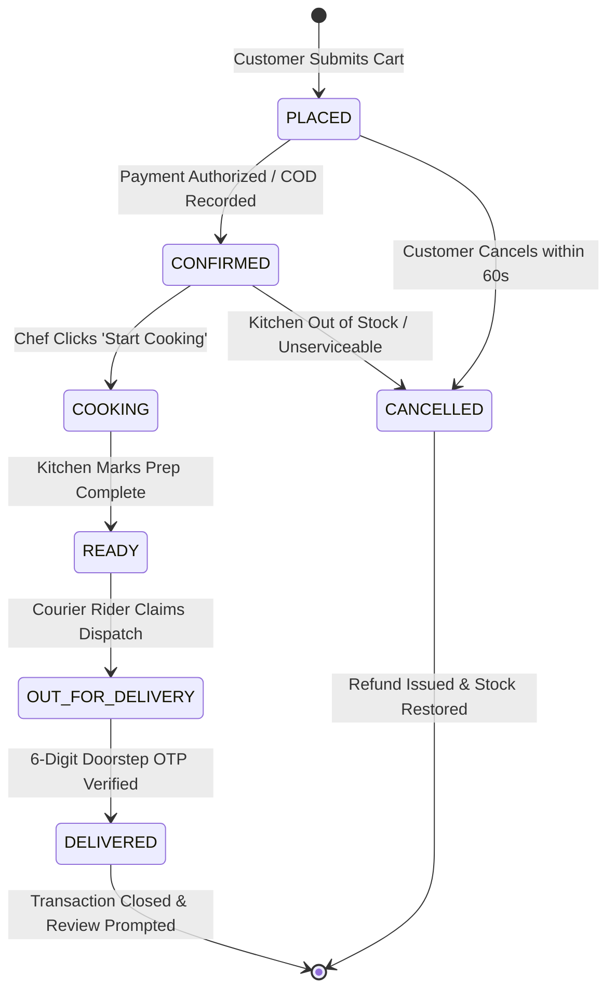

---

### 4.2 Activity Diagrams

#### A. Concurrency-Controlled ACID Checkout & Stock Locking Activity Diagram
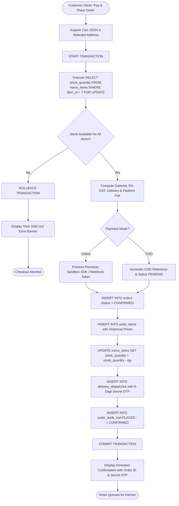

#### B. Kitchen Fulfillment & Doorstep OTP Handshake Activity Diagram
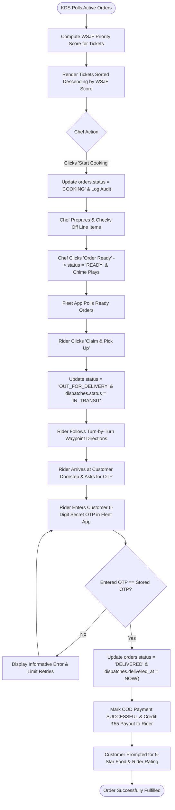

---

### 4.3 UML Domain Class Diagram & Service Architecture
Depicts the computational service architecture, analytical algorithmic engines, and data access controllers underpinning the 3-tier MVC/Service architecture of the platform. Business rules, validation logic, and database mutations are encapsulated within domain service modules and specialized algorithmic classes interacting with the PDO database abstraction layer.

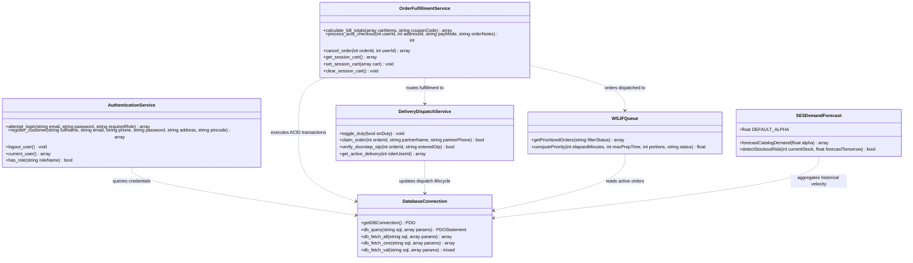

---

### 4.4 Sequence Diagrams

#### A. Customer Order Checkout & Concurrency Locking Sequence Diagram
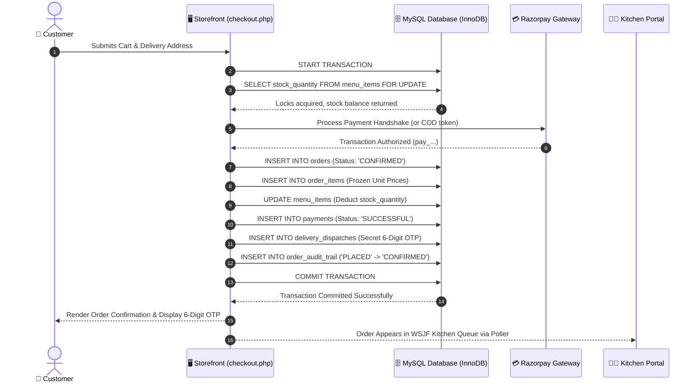

#### B. Doorstep OTP Verification & Order Fulfillment Sequence Diagram
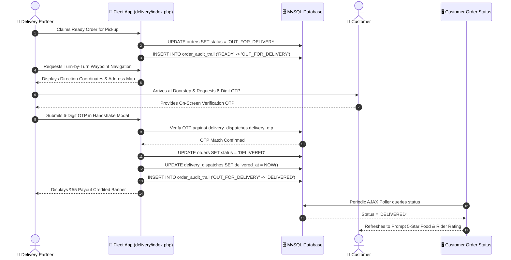

---

### 4.5 Role-Based Access Control (RBAC) Permissions Matrix

| Functional Module / Action | Customer (Role 2) | Kitchen Chef (Role 3) | Delivery Partner (Role 4) | Administrator (Role 1) |
| :--- | :---: | :---: | :---: | :---: |
| **Storefront Catalog & Search** | Read Only | Read Only | Read Only | Full Access |
| **Cart & ACID Order Checkout** | Full Access | No Access | No Access | No Access |
| **View Own Order History & Invoices** | Full Access | No Access | No Access | Full Access |
| **Rate Food Quality & Courier Tip** | Create / Update | No Access | No Access | Read Only |
| **View Dynamic FAQs & Help Desk** | Read Only | Read Only | Read Only | Full Access (CRUD) |
| **Kitchen KDS Queue & Thermal KOT** | No Access | Full Access | No Access | Read / Audit |
| **Advance Order Cooking Milestones** | No Access | Full Access | No Access | Full Access |
| **Fleet Duty Toggle & Order Claiming**| No Access | No Access | Full Access | Read Only |
| **Waypoint Route Navigation & OTP** | No Access | No Access | Full Access | Read Only |
| **Category & Dish Catalog CRUD** | No Access | No Access | No Access | Full Access |
| **Staff & User Account Management** | No Access | No Access | No Access | Full Access |
| **Executive BI & SES Demand Forecast**| No Access | No Access | No Access | Full Access |
| **Regulatory Order Audit Trail Log** | No Access | No Access | No Access | Full Access |

---

### 4.6 Hardware & Software Environment Specifications

#### A. Hardware Requirements
| Component | Minimum Client Spec | Recommended Server Deployment Spec |
| :--- | :--- | :--- |
| **Processor** | Dual-core 1.5 GHz or modern smartphone CPU | Quad-core 2.4 GHz Intel Xeon / AMD EPYC |
| **System Memory (RAM)** | 2 GB RAM | 8 GB DDR4 ECC RAM |
| **Storage** | 500 MB free space (browser caching) | 40 GB NVMe SSD (database & media assets) |
| **Display Resolution** | 360 $\times$ 640 (Mobile) / 1280 $\times$ 720 (Desktop)| 1920 $\times$ 1080 (Admin / KDS Monitor) |
| **Network Interface** | 4G LTE / Wi-Fi (min 256 kbps) | Gigabit Ethernet (1 Gbps uplink) |

#### B. Software Requirements & Architectural Rationale
| Layer | Specification | Technical Selection Rationale |
| :--- | :--- | :--- |
| **Server Operating System** | Ubuntu Linux 22.04 LTS / Windows 11 (XAMPP 8.2) | Enterprise stability, POSIX compliance, and high I/O throughput. |
| **Web Server** | Apache HTTP Server 2.4 (mod_rewrite enabled) | Seamless `.htaccess` routing, URL rewrites, and virtual host security. |
| **Server-Side Runtime** | PHP 8.2+ (Strict Types, PDO MySQL enabled) | High-performance Zend engine, native password hashing, OOP design. |
| **Database Management** | MySQL 8.0 / MariaDB 10.5+ (InnoDB Storage Engine) | Strict ACID compliance, row-level pessimistic locking (`FOR UPDATE`), foreign key cascade enforcement, triggers. |
| **Client Frontend** | HTML5, CSS3, JavaScript (ES6+), Bootstrap 5.3.3 | Responsive cross-device rendering (mobile fleet, touch KDS, desktop admin). |
| **Visualization Libraries** | Chart.js 4.4.2 & FontAwesome 6.5.2 | Lightweight client-side canvas charts for BI reporting and iconography. |
| **Real-Time Polling Engine** | Asynchronous RESTful AJAX (`fetch()` API) | Selected over WebSockets for maximum LAMP stack portability, firewall compatibility, and zero daemon socket maintenance overhead while achieving responsive 3-second live updates. |

---

## 5. PHYSICAL IMPLEMENTATION MAPPING MATRIX

| Subsystem / Portal | Physical Implementation Path | Primary Actors | Use Cases Implemented | Underlying 3NF Relational Tables |
| :--- | :--- | :--- | :--- | :--- |
| Subsystem / Portal | Physical Implementation Path | Primary Actors | Use Cases Implemented | Underlying 3NF Relational Tables |
| :--- | :--- | :--- | :--- | :--- |
| **Customer Storefront** | [`customer/index.php`](file:///e:/2026%20project/2026%20july/Pooja/pooja_project/customer/index.php) [`customer/cart.php`](file:///e:/2026%20project/2026%20july/Pooja/pooja_project/customer/cart.php) [`customer/checkout.php`](file:///e:/2026%20project/2026%20july/Pooja/pooja_project/customer/checkout.php) [`customer/manage-addresses.php`](file:///e:/2026%20project/2026%20july/Pooja/pooja_project/customer/manage-addresses.php) [`customer/order-status.php`](file:///e:/2026%20project/2026%20july/Pooja/pooja_project/customer/order-status.php) [`customer/order-history.php`](file:///e:/2026%20project/2026%20july/Pooja/pooja_project/customer/order-history.php) [`customer/invoice.php`](file:///e:/2026%20project/2026%20july/Pooja/pooja_project/customer/invoice.php) [`customer/rate-order.php`](file:///e:/2026%20project/2026%20july/Pooja/pooja_project/customer/rate-order.php) [`customer/help.php`](file:///e:/2026%20project/2026%20july/Pooja/pooja_project/customer/help.php) [`customer/login.php`](file:///e:/2026%20project/2026%20july/Pooja/pooja_project/customer/login.php) | Customer (Role 2) | **UC-01 to UC-11** (Registration, Address CRUD, Catalog Browsing & Search, 60s Order Cancellation & Refund, Cart Management, Coupons, ACID Checkout, Payment & Webhooks, Live Tracking & Dynamic ETA, Rating & Reviews, Help Desk & Tickets) | `users`, `user_addresses`, `categories`, `menu_items`, `orders`, `order_items`, `payments`, `delivery_dispatches`, `order_audit_trail`, `order_reviews`, `faqs`, `support_tickets` |
| **Delivery Partner Fleet Portal (Delivery Boy)** | [`delivery/index.php`](file:///e:/2026%20project/2026%20july/Pooja/pooja_project/delivery/index.php) [`delivery/login.php`](file:///e:/2026%20project/2026%20july/Pooja/pooja_project/delivery/login.php) | Courier Rider (Role 4: Suresh Kumar) | **UC-14** (Duty Toggle) **UC-15** (Claim Dispatch) **UC-16** (Waypoint Route) **UC-17** (Doorstep OTP Handshake) | `users`, `orders`, `order_items`, `delivery_dispatches`, `payments`, `order_audit_trail` |
| **Kitchen Display System (KDS)** | [`kitchen/index.php`](file:///e:/2026%20project/2026%20july/Pooja/pooja_project/kitchen/index.php) [`kitchen/login.php`](file:///e:/2026%20project/2026%20july/Pooja/pooja_project/kitchen/login.php) [`kitchen/kot.php`](file:///e:/2026%20project/2026%20july/Pooja/pooja_project/kitchen/kot.php) | Kitchen Chef (Role 3: Chef Sanjeev) | **UC-12** (WSJF Prioritized Queue) **UC-13** (Cooking & Ready Milestones) | `orders`, `order_items`, `menu_items`, `order_audit_trail` |
| **Restaurant Admin Console** | [`admin/index.php`](file:///e:/2026%20project/2026%20july/Pooja/pooja_project/admin/index.php) [`admin/orders.php`](file:///e:/2026%20project/2026%20july/Pooja/pooja_project/admin/orders.php) [`admin/dishes.php`](file:///e:/2026%20project/2026%20july/Pooja/pooja_project/admin/dishes.php) [`admin/categories.php`](file:///e:/2026%20project/2026%20july/Pooja/pooja_project/admin/categories.php) [`admin/users.php`](file:///e:/2026%20project/2026%20july/Pooja/pooja_project/admin/users.php) [`admin/reports.php`](file:///e:/2026%20project/2026%20july/Pooja/pooja_project/admin/reports.php) [`admin/audit-logs.php`](file:///e:/2026%20project/2026%20july/Pooja/pooja_project/admin/audit-logs.php) [`admin/faqs.php`](file:///e:/2026%20project/2026%20july/Pooja/pooja_project/admin/faqs.php) | Administrator (Role 1: Pooja JP) | **UC-18 to UC-23** (Menu CRUD, Category Taxonomy, Staff RBAC & Self-Deactivation Guard, SES Demand Forecasting, Audit Ledger, Dynamic FAQ Desk) | `roles`, `users`, `categories`, `menu_items`, `orders`, `order_items`, `payments`, `delivery_dispatches`, `order_audit_trail`, `faqs`, `support_tickets` |
| **Asynchronous REST AJAX & Webhook APIs** | [`api/payment-webhook.php`](file:///e:/2026%20project/2026%20july/Pooja/pooja_project/api/payment-webhook.php) [`customer/ajax/order-status-api.php`](file:///e:/2026%20project/2026%20july/Pooja/pooja_project/customer/ajax/order-status-api.php) [`kitchen/ajax/poll-orders.php`](file:///e:/2026%20project/2026%20july/Pooja/pooja_project/kitchen/ajax/poll-orders.php) [`admin/ajax/update-order-status.php`](file:///e:/2026%20project/2026%20july/Pooja/pooja_project/admin/ajax/update-order-status.php) | Payment Gateway / Client Poller Engines | **UC-08** (Asynchronous Payment Capture) **UC-09** (Storefront Dynamic ETA & Polling) **UC-12** (KDS Polling Engine) | `payments`, `orders`, `order_items`, `menu_items`, `order_audit_trail`, `delivery_dispatches` |

---

## 6. FUTURE SCOPE & SYSTEM ENHANCEMENTS

To advance the platform from an academic major project into an enterprise-scale commercial ecosystem, the following eight technical enhancement avenues are established:

### 6.1 AI-Powered Conversational Voice Ordering (Multilingual NLP)
* **Architecture:** Integration of Whisper ASR (Automatic Speech Recognition) and fine-tuned open-source LLMs (Llama 3 / Mistral) via streaming endpoints.
* **Impact:** Enables voice ordering in regional Indian languages (Hindi, Kannada, Malayalam, Tamil) for non-tech-savvy and visually impaired users.
* **Mechanism:** Converts audio streams into structured JSON cart intents (`{"action": "ADD_TO_CART", "item": "Chicken Biryani", "qty": 2}`).

### 6.2 Autonomous Drone & Robotic Delivery Fleet Integration
* **Architecture:** Unmanned Aerial Vehicle (UAV) dispatch integration using MAVLink protocols and UTM (Unmanned Traffic Management) APIs.
* **Impact:** Drastically bypasses urban traffic bottlenecks in metropolitan zones, reducing last-mile delivery times from 40 minutes to under 12 minutes for perishable meals.
* **Mechanism:** Automatic calculation of payload weight limits against dish orders and geofenced safe landing waypoint verification.

### 6.3 Dynamic Surge Pricing & Predictive Kitchen Load Balancing
* **Architecture:** Reinforcement learning agent trained on historical weather radar APIs (OpenWeather), live traffic congestion (Google Distance Matrix), and pending kitchen queue depths.
* **Impact:** Prevents kitchen burnout during extreme rain or festival peaks by dynamically adjusting delivery fees and throttling order acceptance windows.

### 6.4 Blockchain-Enabled Farm-to-Fork Food Traceability
* **Architecture:** Hyperledger Fabric private permissioned blockchain recording supplier meat/produce batch certificates and cold-chain temperature telemetry.
* **Impact:** Provides tamper-proof verification of organic claims, Halal certification, and food freshness timestamps accessible to customers via on-box QR code scans.

### 6.5 Multi-Tenant Cloud Kitchen SaaS Architecture
* **Architecture:** Transition from single-restaurant deployment to a multi-tenant microservices model with horizontal pod autoscaling on Kubernetes (EKS/GKE).
* **Impact:** Allows the platform to onboard thousands of independent restaurant brands with isolated tenant databases, custom domains, and automated billing tiers.

### 6.6 IoT Connected Smart Kitchen Appliance Telemetry
* **Architecture:** MQTT broker integration with smart ovens, deep fryers, and digital weight scales.
* **Impact:** Automatically notifies the Kitchen Display System (KDS) when a fryer reaches target temperature or when bulk ingredient containers drop below reserve thresholds.

### 6.7 Multi-Drop Fleet Routing via Genetic Algorithms
* **Architecture:** Vehicle Routing Problem with Time Windows (VRPTW) solved using Genetic Algorithms and Ant Colony Optimization.
* **Impact:** Bundles orders from neighboring food outlets destined for adjacent residential apartments to a single rider, slashing fleet fuel consumption and carbon footprint by 35%.

### 6.8 Offline-First Progressive Web App (PWA) with Biometric Passkeys
* **Architecture:** WebAuthn standard with FIDO2 hardware passkeys (fingerprint / FaceID) paired with Service Workers and IndexedDB cache storage.
* **Impact:** Allows users in low-connectivity 2G/3G zones to browse menus and curate offline carts that automatically synchronize when network connectivity resumes.

---
*End of System Analysis & Design Specification (MCSP-232)*
