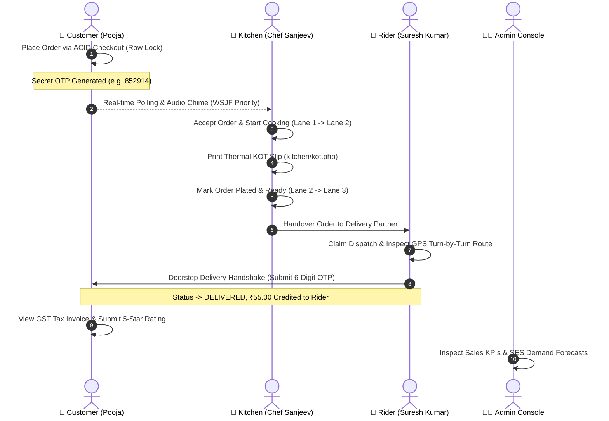

# 🚀 Zippy — How to Run on Your Laptop

> **Project:** Zippy – Online Food Ordering Platform  
> **Course:** MCSP-232 (MCA Major Project) | **University:** IGNOU  
> **Student:** Pooja JP (Enrollment No: `2500051247`)  
> **Stack:** PHP 8.1+ / 8.2+ + MariaDB 10.6+ / MySQL 8.0+ (InnoDB) + Bootstrap 5.3 + Vanilla JS  
> **Design System:** Figma "Lush Forest" Color Palette (#Combination-4)  
> **Version:** 2.0.0-MCA (Post-Reorganization Architecture)

---

## 📋 Prerequisites

| Software | Minimum Version | Download Link | Notes |
|:---|:---:|:---|:---|
| **PHP** | 8.1 or later (8.2 recommended) | [windows.php.net](https://windows.php.net/download/) | Thread Safe or NTS (x64) |
| **MariaDB** or **MySQL** | MariaDB 10.6+ / MySQL 8.0+ | [mariadb.org](https://mariadb.org/download/) / [mysql.com](https://dev.mysql.com/downloads/installer/) | InnoDB Storage Engine required |
| **Web Browser** | Modern (Chrome, Edge, Firefox) | Pre-installed | JavaScript & LocalStorage enabled |

> 💡 **Tip — All-in-One Alternative (XAMPP / WampServer / Laragon):**  
> If you prefer not to configure standalone PHP and MySQL, install **XAMPP (v8.1+)**. It bundles both PHP 8.x and MariaDB/MySQL. If using XAMPP, skip manual service steps and simply click **Start** for **Apache** and **MySQL** in the XAMPP Control Panel.

### Required PHP Extensions
Ensure the following extensions are enabled in your `php.ini` file (remove the leading `;` if commented out):

```ini
extension=pdo_mysql
extension=mbstring
extension=openssl
extension=curl
```

To quickly verify your enabled extensions from PowerShell:
```powershell
php -m | Select-String -Pattern "pdo_mysql|mbstring|openssl"
```

---

## ⚙️ Environment Configuration (`.env`)

The project supports zero-dependency environment configuration via `.env` with automatic fallback to standard defaults.

1. In the `pooja_project` folder, copy the example template to create your `.env` file:
   ```powershell
   cd "E:\2026 project\2026 july\Pooja\pooja_project"
   copy .env.example .env
   ```

2. Inspect or edit `.env` if your local database uses a custom password or non-standard port:
   ```env
   # Database Credentials
   DB_HOST=127.0.0.1
   DB_PORT=3306
   DB_NAME=zippy_db
   DB_USER=root
   DB_PASS=

   # Environment Settings
   APP_ENV=development
   APP_DEBUG=true

   # Razorpay Test Mode Credentials (Standard Sandbox)
   RAZORPAY_KEY_ID=rzp_test_1DP5mmOlF5G5ag
   RAZORPAY_KEY_SECRET=dummy_secret_key
   ```

> ℹ️ **Note:** If no `.env` file exists, the system automatically defaults to `127.0.0.1:3306`, user `root`, empty password, database `zippy_db`, and test key `rzp_test_1DP5mmOlF5G5ag`.

---

## 🛠️ Step 1 — Start the Database Server

### Option A: Via XAMPP / WampServer (Easiest)
1. Open the **XAMPP Control Panel**.
2. Click **Start** next to **MySQL** (and **Apache** if you plan to access via `http://localhost/Pooja/pooja_project/`).
3. Ensure the MySQL status turns green and port `3306` is shown.

### Option B: Standalone / Portable MariaDB or MySQL
1. Open a **PowerShell** terminal.
2. Initialize data directory (first time only, if using portable ZIP):
   ```powershell
   & "C:\path\to\mariadb\bin\mysql_install_db.exe" --datadir="C:\path\to\mariadb\data"
   ```
3. Start the daemon:
   ```powershell
   & "C:\path\to\mariadb\bin\mysqld.exe" --console
   ```
   *(Keep this terminal open while running the app)*

### Option C: Windows Service (Installed MySQL / MariaDB)
If installed as a Windows background service, start it from an elevated terminal:
```powershell
net start MySQL
# or for MySQL 8.0:
net start MySQL80
```

---

## 🗄️ Step 2 — Create the Relational Database

Open a new PowerShell terminal and run the following command to ensure the `zippy_db` database exists with full UTF-8 Unicode support:

```powershell
# If MySQL is in your system PATH:
mysql -u root -e "CREATE DATABASE IF NOT EXISTS zippy_db CHARACTER SET utf8mb4 COLLATE utf8mb4_unicode_ci;"

# Or using the absolute path to your MySQL / MariaDB binary:
& "C:\xampp\mysql\bin\mysql.exe" -u root -e "CREATE DATABASE IF NOT EXISTS zippy_db CHARACTER SET utf8mb4 COLLATE utf8mb4_unicode_ci;"
```

*Alternatively, open **phpMyAdmin** (`http://127.0.0.1/phpmyadmin`) → click **New** → create a database named `zippy_db` with Collation `utf8mb4_unicode_ci`.*

---

## 🌐 Step 3 — Start the PHP Web Server

Open a PowerShell terminal, navigate to the `pooja_project` folder, and launch PHP's built-in development server:

```powershell
cd "E:\2026 project\2026 july\Pooja\pooja_project"

php -S 127.0.0.1:8080 -t .
```

You should see:
```text
[Sat Oct  3 21:45:00 2026] PHP 8.2.x Development Server (http://127.0.0.1:8080) started
```

> ⚠️ **Keep this terminal window open.** It serves all HTTP traffic, static assets, and AJAX API requests for all 4 portals.

---

## ⚡ Step 4 — Run the Automated Database Seeder

Once the server and database are running, open your browser and visit the automated seeder:

👉 **[http://127.0.0.1:8080/database/seed.php](http://127.0.0.1:8080/database/seed.php)**

*Or run directly via command line:*
```powershell
cd "E:\2026 project\2026 july\Pooja\pooja_project"
php database/seed.php
```

### What the Seeder Automatically Executes:
1. **Creates All 13 Normalized 3NF Relational Tables:**
   - `roles`: Role-Based Access Control catalog (`ADMIN`, `CUSTOMER`, `KITCHEN`, `RIDER`).
   - `users`: User profiles with Argon2id / Bcrypt password hashing and active flags.
   - `user_addresses`: 1-to-many customer delivery addresses with default indicators.
   - `categories`: Menu categorization with slugs, display order, and active toggles.
   - `menu_items`: Dish catalog with pricing (`CHECK (price > 0)`), live stock, prep time, veg/non-veg tags, and kitchen station routing.
   - `orders`: Master order ledger with human-friendly `#ZIP-` code, subtotal, 5% GST, platform fee, coupon code, and real-time status.
   - `order_items`: Immutable transactional line items capturing quantities (`CHECK (quantity > 0)`) and historical unit prices.
   - `payments`: Payment transaction records (COD, UPI, Card, NetBanking) with gateway references and refund tracking (`REFUNDED`).
   - `delivery_dispatches`: Last-mile dispatch logs containing assigned riders, 6-digit verification OTPs, and timestamps.
   - `order_audit_trail`: Immutable chronological audit log recording every lifecycle status transition and event actor.
   - `order_reviews`: Post-delivery feedback capturing food culinary rating (1-5), courier rating (1-5), optional tips, and qualitative comments.
   - `faqs`: Dynamic knowledge base and help desk categories managed via Admin.
   - `support_tickets`: Customer support inquiry tickets with status workflow (`OPEN`, `IN_PROGRESS`, `RESOLVED`, `CLOSED`).
2. **Installs ACID MySQL Triggers:**
   - `trg_order_status_audit`: Automatically inserts an audit entry whenever `orders.order_status` transitions.
   - `trg_deduct_menu_stock`: Real-time stock balance adjustments upon order placement.
3. **Populates Seed Data & Sample Transactions:**
   - Pre-seeds authentic Indian culinary categories (Biryanis, Curries, Breads, Beverages, Desserts).
   - Seeds popular dishes with prep times and initial inventory reserves.
   - Seeds historical multi-item orders to initialize the **Weighted Shortest Job First (WSJF)** queue and **SES Demand Forecast Model**.
   - Encrypts all user passwords securely (`password123`).

---

## 🖥️ Step 5 — Access the Application Portals

Open your browser to test and evaluate each specialized subsystem:

| Portal | Direct URL | Description & Key Responsibilities |
|:---|:---|:---|
| 🚀 **Master Launchpad Hub** | [http://127.0.0.1:8080/index.php](http://127.0.0.1:8080/index.php) | Central portal switcher, system health diagnostics, database connection status, and project overview. |
| 🛒 **Customer Storefront** | [http://127.0.0.1:8080/customer/index.php](http://127.0.0.1:8080/customer/index.php) | Customer menu browsing, live search, veg filters, dynamic category tabs, cart drawer, coupons, 60s cancellation, and ACID checkout. |
| 💬 **Customer Help Desk & Tickets** | [http://127.0.0.1:8080/customer/help.php](http://127.0.0.1:8080/customer/help.php) | Dynamic accordion FAQs from `faqs` table, customer support ticket submission persisted in `support_tickets`. |
| 🍳 **Kitchen Display (KDS)** | [http://127.0.0.1:8080/kitchen/index.php](http://127.0.0.1:8080/kitchen/index.php) | Chef workspace with dynamic Weighted Shortest Job First (WSJF) priority Kanban, live audio alerts, stove timers, and handover controls. |
| 🧾 **Thermal KOT Slip** | [http://127.0.0.1:8080/kitchen/kot.php?order_id=1](http://127.0.0.1:8080/kitchen/kot.php?order_id=1) | Clean, print-ready 80mm thermal Kitchen Order Ticket generator for kitchen line cooks. |
| 🚴 **Delivery Partner Fleet** | [http://127.0.0.1:8080/delivery/index.php](http://127.0.0.1:8080/delivery/index.php) | Courier app with Online/Offline duty toggle, dispatch claiming, turn-by-turn simulated GPS map, 6-digit OTP doorstep verification, and shift earnings. |
| 👨‍💼 **Admin Operations Console** | [http://127.0.0.1:8080/admin/index.php](http://127.0.0.1:8080/admin/index.php) | Executive KPI dashboard, full order lifecycle dispatcher, category/dish CRUD with 86-list toggle, staff RBAC management, and BI analytics. |
| 🍲 **Menu & Stock Management** | [http://127.0.0.1:8080/admin/dishes.php](http://127.0.0.1:8080/admin/dishes.php) | Catalog CRUD for dishes, real-time portion inventory adjustments, pricing, and vegetarian toggles. |
| 👥 **Staff RBAC Administration** | [http://127.0.0.1:8080/admin/users.php](http://127.0.0.1:8080/admin/users.php) | User & staff role management with self-deactivation protection preventing admin lockouts. |
| 📜 **Regulatory Audit Logs** | [http://127.0.0.1:8080/admin/audit-logs.php](http://127.0.0.1:8080/admin/audit-logs.php) | Immutable chronological ledger of order lifecycle transitions, actor IDs, and timestamps. |
| ❓ **Dynamic FAQ Manager** | [http://127.0.0.1:8080/admin/faqs.php](http://127.0.0.1:8080/admin/faqs.php) | Knowledge base management to add, update, reorder, or toggle storefront FAQs. |
| 📊 **BI & SES Forecasts** | [http://127.0.0.1:8080/admin/reports.php](http://127.0.0.1:8080/admin/reports.php) | Business intelligence charts (Chart.js) and Single Exponential Smoothing ($\alpha=0.3$) demand forecasts. |

---

## 🔑 Demo Login Credentials

All test accounts share the universal demo password: **`password123`**  
*(Every login page also provides convenient **1-Click Demo Login** buttons for instant evaluation)*

| Role | Name | Email | Password | Dedicated Login Portal |
|:---|:---|:---|:---:|:---|
| 🔴 **Admin** | Pooja JP (Admin) | `admin@zippy.com` | `password123` | [`admin/login.php`](http://127.0.0.1:8080/admin/login.php) |
| 🟢 **Customer** | Pooja JP (Customer) | `pooja@example.com` | `password123` | [`customer/login.php`](http://127.0.0.1:8080/customer/login.php) |
| 🟢 **Customer** | Rahul Sharma | `rahul@example.com` | `password123` | [`customer/login.php`](http://127.0.0.1:8080/customer/login.php) |
| 🟡 **Kitchen Chef** | Chef Sanjeev | `chef@zippy.com` | `password123` | [`kitchen/login.php`](http://127.0.0.1:8080/kitchen/login.php) |
| 🔵 **Delivery Rider** | Suresh Kumar | `rider@zippy.com` | `password123` | [`delivery/login.php`](http://127.0.0.1:8080/delivery/login.php) |

---

## 🔄 Complete End-to-End Test Walkthrough

Follow this 6-stage walkthrough to simulate a live, multi-actor order cycle across all 4 portals:



### Stage 1: Customer Ordering & Checkout (Razorpay Test Gateway)
1. Open [http://127.0.0.1:8080/customer/login.php](http://127.0.0.1:8080/customer/login.php).
2. Click the **"Customer Demo Login"** button (or enter `pooja@example.com` / `password123`).
3. Browse the storefront:
   - Use the **Veg Only** toggle to filter vegetarian dishes.
   - Search for dishes (e.g., "Biryani" or "Paneer") via [`customer/search.php`](http://127.0.0.1:8080/customer/search.php).
   - Add **Hyderabadi Chicken Biryani** to cart.
   - Review dish culinary descriptions, preparation times, vegetarian badges, and live portion availability.
4. Open the Cart Drawer or go to [`customer/cart.php`](http://127.0.0.1:8080/customer/cart.php):
   - Enter promo code `LUSHFOREST` or `ZIPPY50` to apply promotional discounts.
5. Click **"Proceed to Checkout"** ([`customer/checkout.php`](http://127.0.0.1:8080/customer/checkout.php)):
   - Select a saved delivery address (or enter a new address via [`customer/manage-addresses.php`](http://127.0.0.1:8080/customer/manage-addresses.php)).
   - Under **"4. Select Payment Method"**, choose any **Razorpay Online Sandbox** option:
     * ⚡ **Instant UPI via Razorpay:** Test VPA `success@razorpay` (or 1-click Pay).
     * 💳 **Credit / Debit Card via Razorpay:** Test card `4111 1111 1111 1111`, Expiry `12/28`, CVV `123`, OTP `123456`.
     * 🏦 **Net Banking via Razorpay:** Any bank sandbox auth.
     * *(Or choose Cash on Delivery for pending cash settlement).*
   - Click **"Pay & Place Order"**:
     * The official **Razorpay Checkout Sandbox Modal** (or built-in offline test sandbox modal) will appear with the calculated bill amount in paise.
     * Click **"Simulate Successful Payment (Instant)"** or enter test credentials to authorize the payment.
   - *Technical Note:* The checkout executes inside a MySQL `START TRANSACTION`, acquiring row-level pessimistic locks (`SELECT ... FOR UPDATE`) on dishes to verify and decrement stock atomically, records the human-friendly `#ZIP-` order number, platform fee, coupon code, Razorpay payment token (`pay_...`) in `payments` with status `SUCCESSFUL`, logs to `order_audit_trail`, and generates the 6-digit delivery OTP.
6. On [`customer/order-success.php`](http://127.0.0.1:8080/customer/order-success.php):
   - Note the **🌿 Razorpay Test Verified** badge displaying your generated transaction reference (e.g. `pay_rzp_test_...`).
   - Note the **6-digit Secret Delivery OTP** (e.g. `852914`).
   - Click **"Track Live Order"** to view real-time status at [`customer/order-status.php`](http://127.0.0.1:8080/customer/order-status.php).
   - *Cancellation Safety Feature:* On [`customer/order-status.php`](http://127.0.0.1:8080/customer/order-status.php), observe the live **60-Second Cancellation Timer**. If clicked within 60s, the system cancels the order atomically, marks the payment as `REFUNDED`, restores inventory portions, and logs the transition in `order_audit_trail`.

### Stage 2: Kitchen Display System (KDS) & Thermal KOT
1. Open a new window or tab: [http://127.0.0.1:8080/kitchen/login.php](http://127.0.0.1:8080/kitchen/login.php).
2. Click **"1-Click Chef Login"** (`chef@zippy.com`).
3. In the KDS interface:
   - Notice that incoming orders are dynamically prioritized using the **Weighted Shortest Job First (WSJF)** algorithm.
   - An audible chime alerts line cooks when new tickets arrive.
4. **Lane 1 ("Incoming Tickets"):** Click **"Accept & Start Cooking"**. The ticket moves to Lane 2.
5. Click **"Print KOT"** to view and print the formatted 80mm thermal Kitchen Order Ticket (`kitchen/kot.php?order_id=...`).
6. **Lane 2 ("In Cooking"):** Check off prepared items on the prep checklist, then click **"Order Plated & Ready"**. The ticket moves to Lane 3.
7. **Lane 3 ("Ready for Dispatch"):** Review the assigned delivery partner (Suresh Kumar) and packaging items, then click **"Hand Over to Delivery Boy"**.
8. Ticket shifts to `OUT_FOR_DELIVERY` and notifies the rider!

### Stage 3: Delivery Partner Dispatch & Route Navigation
1. Open a new window or tab: [http://127.0.0.1:8080/delivery/login.php](http://127.0.0.1:8080/delivery/login.php).
2. Click **"1-Click Rider Login"** (`rider@zippy.com`).
3. Ensure the duty switch in the top bar is set to **ONLINE**. (Note: An on-duty security guard prevents couriers from claiming tickets while set to OFFLINE).
4. In the active dispatch section:
   - Under "Bagged & Ready for Pickup at Kitchen", click **"Accept & Pick Up Order"**.
   - The ticket shifts into active transit.
5. Click **"Turn-by-Turn GPS Map"**:
   - Inspect the interactive routing modal displaying step-by-step turn directions, simulated transit speed, remaining distance, and a 1-click customer phone dialer (`tel:`).

### Stage 4: Doorstep OTP Handshake & Settlement
1. In the rider's active dispatch card, click **"Verify Customer OTP & Finish"**.
2. Enter the **6-digit Secret Delivery OTP** from Customer Stage 1 (e.g., `852914`).
3. Click **"Confirm & Complete Delivery"**:
   - The system validates the OTP against `delivery_dispatches.delivery_otp`.
   - On match: Order status transitions to **DELIVERED**.
   - Delivery timestamp is recorded (`delivered_at = NOW()`).
   - If COD, payment status updates to `SUCCESSFUL`.
   - Rider trip fee (**₹55.00**) is credited to the rider's shift earnings ledger.
   - The event is immutably logged into `order_audit_trail`.

### Stage 5: Customer Post-Order Experience & Invoice
1. Return to the customer's tracking page tab ([`customer/order-status.php`](http://127.0.0.1:8080/customer/order-status.php)):
   - The AJAX status poller automatically detects the delivery completion, updates the milestone stepper to **Delivered**, and automatically pops open the **5-Star Rating Prompt Modal** (`#autoRatingPromptModal`).
2. Rate the order:
   - Submit culinary quality rating (1-5 stars), delivery service rating (1-5 stars), optional tip, and feedback comments (persisted in `order_reviews`).
3. Click **"Download Tax Invoice"** ([`customer/invoice.php`](http://127.0.0.1:8080/customer/invoice.php)):
   - View the official Indian GST Tax Invoice with SAC Service Code `996331`, 2.5% CGST, 2.5% SGST, and restaurant tax details.
4. Visit the **Customer Help Desk ([`customer/help.php`](http://127.0.0.1:8080/customer/help.php))**:
   - Browse dynamic accordion FAQs loaded from the database or submit support inquiries saved directly to the `support_tickets` table.

### Stage 6: Admin Operations, RBAC & Demand Forecasting
1. Open [http://127.0.0.1:8080/admin/login.php](http://127.0.0.1:8080/admin/login.php) and sign in as Admin (`admin@zippy.com`).
2. Explore the executive features:
   - **Dashboard ([`admin/index.php`](http://127.0.0.1:8080/admin/index.php)):** View real-time sales KPIs, active orders, customer counts, and order audit stream.
   - **Orders Dispatcher ([`admin/orders.php`](http://127.0.0.1:8080/admin/orders.php)):** Inspect complete order histories, manual cancellation with inventory restock, and lifecycle transitions.
   - **Menu & Stock Management ([`admin/dishes.php`](http://127.0.0.1:8080/admin/dishes.php)):** Update pricing, adjust prep times, edit dish details, and toggle 86-list availability.
   - **Category Taxonomy ([`admin/categories.php`](http://127.0.0.1:8080/admin/categories.php)):** Manage category titles, slugs, and display sorting order.
   - **Staff RBAC & Security ([`admin/users.php`](http://127.0.0.1:8080/admin/users.php)):** Create and manage staff accounts (Admins, Chefs, Couriers) with a built-in self-deactivation guard preventing administrator lockout.
   - **Regulatory Audit Trail ([`admin/audit-logs.php`](http://127.0.0.1:8080/admin/audit-logs.php)):** Inspect immutable chronological audit logs tracking actors, timestamps, and status changes.
   - **Dynamic FAQ Desk ([`admin/faqs.php`](http://127.0.0.1:8080/admin/faqs.php)):** Add, edit, reorder, or toggle visibility of storefront FAQs.
   - **BI Reports & SES Forecasting ([`admin/reports.php`](http://127.0.0.1:8080/admin/reports.php)):** Review Chart.js sales visuals and Single Exponential Smoothing ($\alpha = 0.3$) demand forecasts to predict ingredient requirements and prevent stockouts.

---

## 💳 Testing Razorpay Dummy / Sandbox Payments

The system integrates the **Razorpay Standard Checkout** workflow with full dual-mode sandbox support (online via official CDN and offline via built-in resilient test simulator).

### Test Credentials Reference:
| Payment Mode | Test Credential / Value | Expected Behavior |
|:---|:---|:---|
| **UPI** | `success@razorpay` | Instant authorization approval via dummy VPA |
| **Visa Test Card** | `4111 1111 1111 1111` (Exp: any future e.g. `12/28`, CVV: `123`) | OTP screen (`123456`) -> Successful authorization |
| **MasterCard Test**| `5123 4567 8901 2346` (Exp: any future, CVV: `123`) | Successful sandbox authorization |
| **Net Banking** | Any Indian Bank (HDFC, ICICI, SBI, Axis, Kotak) | Simulated bank redirect & instant approval |
| **Failure Testing**| Click **"Simulate Payment Failure"** in test modal | Displays realistic bank decline error without submitting order |

### Dual-Mode Architecture (Online + Offline Resilient):
1. **Online Mode (Internet Connected):**  
   Invokes the official Razorpay JS SDK (`https://checkout.razorpay.com/v1/checkout.js`) with key `rzp_test_1DP5mmOlF5G5ag`. Opens Razorpay's branded modal themed in Zippy's Lush Forest green (`#2E6F40`).
2. **Offline Mode (Local / Viva Defense / Restricted Network):**  
   If the browser cannot reach `checkout.razorpay.com` (e.g. offline evaluation), the checkout automatically launches the built-in **Razorpay Test Sandbox Simulator Modal**. Clicking **"Simulate Successful Payment (Instant)"** generates an authentic `pay_rzp_test_...` transaction reference token and completes the ACID checkout seamlessly.

### Where to Verify the Razorpay Payment in the System:
1. **Customer Order Confirmation ([`customer/order-success.php`](http://127.0.0.1:8080/customer/order-success.php)):**  
   Shows payment mode (`UPI` or `CREDIT_CARD`), transaction reference (`pay_...`), and the green **🌿 Razorpay Test Verified** badge.
2. **Customer Live Tracking ([`customer/order-status.php`](http://127.0.0.1:8080/customer/order-status.php)):**  
   Summary card displays `Payment Status: SUCCESSFUL` and the full transaction reference code.
3. **Official Indian GST Tax Invoice ([`customer/invoice.php`](http://127.0.0.1:8080/customer/invoice.php)):**  
   Prints the Razorpay Transaction Reference (`Ref: pay_...`) directly on the SAC 996331 tax invoice.
4. **Relational Database (`payments` table):**  
   Row inserted with `transaction_reference = 'pay_...'`, `payment_status = 'SUCCESSFUL'`, and `amount_paid`.

## 🧠 Master's Degree (MCA) Algorithmic Implementations

The platform features 6 core computational algorithms and advanced software engineering patterns designed to satisfy MCA major project evaluation standards:

1. **Dynamic Kitchen Queue Scheduling (WSJF) — `includes/WSJFQueue.php`:**
   $$\text{WSJF Priority Score} = \frac{\text{Cost of Delay (Elapsed Wait Time)}}{\text{Job Duration (Max Prep Time + Portions)}}$$
   - Dynamically reorders kitchen tickets so that orders experiencing delay automatically bubble up the stove queue.

2. **Single Exponential Smoothing (SES) Demand Forecasting — `includes/SESDemandForecast.php`:**
   $$\hat{Y}_{t+1} = \alpha Y_t + (1 - \alpha)\hat{Y}_t \quad (\alpha = 0.3)$$
   - Analyzes dish order velocities to project next-day and weekend culinary demand, highlighting dishes at risk of stock depletion.

3. **High-Concurrency ACID Checkout with Row-Level Locking — `customer/checkout.php`:**
   - Utilizes `SELECT ... FOR UPDATE` within database transactions to ensure two concurrent users cannot purchase the final portion of a dish under race conditions.

4. **Cryptographic Doorstep Handshake (6-Digit OTP) — `delivery/index.php`:**
   - Generates a cryptographically random 6-digit OTP stored in `delivery_dispatches.delivery_otp`. Couriers cannot close delivery tickets without entering the customer's code, eliminating dispute anomalies.

5. **Atomic 60-Second Order Cancellation & Automated Refund Engine — `customer/order-status.php`:**
   - Enforces a temporal threshold ($\le 60\text{s}$) where customers can trigger an atomic cancellation that transitions order status to `CANCELLED`, reverses the payment to `REFUNDED`, restores dish stock quantities, and records an audit trail event.

6. **Real-Time Asynchronous State Polling & Multi-Actor Synchronization — `customer/ajax/order-status-api.php` & `kitchen/ajax/poll-orders.php`:**
   - Non-blocking client polling engine providing responsive status synchronization across Customer, Kitchen, Delivery, and Admin portals without heavy daemon socket infrastructure.

---

## 📁 Clean Reorganized Project Directory Structure

Following the structural reorganization in Commit `6a38551`, the codebase adheres to a clean, non-redundant architecture:

```text
pooja_project/
├── .env.example                       # Environment configuration template
├── .gitignore                         # Standard version control exclusions (.env, vendor, OS caches)
├── index.php                          # Master Portals Launchpad & System Status
├── README.md                          # Comprehensive project & architecture overview
├── run.md                             # ← Local execution guide (This Document)
│
├── api/                               # 🌐 External API & Webhook Endpoints
│   └── payment-webhook.php            # Asynchronous payment capture & webhook listener
│
├── config/                            # Global System Configuration
│   ├── config.php                     # App constants, URLs, sessions, CSRF helpers, formatting
│   └── database.php                   # Canonical PDO MySQL singleton & automatic .env loader
│
├── database/                          # Relational Database Engine
│   ├── schema.sql                     # Canonical 13-table 3NF schema with triggers & seeds
│   └── seed.php                       # One-click CLI & web automated database installer
│
├── includes/                          # Shared Services & Computational Algorithms
│   ├── functions.php                  # Shared DB query wrappers, bill totals, coupon engine
│   ├── auth.php                       # Session-based RBAC authentication & authorization
│   ├── WSJFQueue.php                  # Algorithm 1: Dynamic WSJF Kitchen Queue Scheduling
│   └── SESDemandForecast.php          # Algorithm 2: Exponential Smoothing Demand Forecast
│
├── assets/                            # Shared Client Assets (Figma "Lush Forest" Palette)
│   ├── css/style.css                  # Design system CSS (custom properties, responsive layout)
│   └── js/app.js                      # Persistent cart, drawer engine, toasts, live calculations
│
├── customer/                          # 🛒 Customer Food Ordering Storefront
│   ├── index.php                      # Storefront home (Hero, categories, popular dishes)
│   ├── restaurant.php                 # Restaurant menu, veg switch, dietary filters
│   ├── cart.php                       # Dedicated cart page & coupon application
│   ├── checkout.php                   # Multi-step checkout with ACID transaction & row locking
│   ├── order-success.php              # Order confirmation with generated OTP & tracker link
│   ├── order-status.php               # Live tracking stepper with dynamic ETA, 60s cancellation & auto-rating
│   ├── order-history.php              # Past order history with Repeat Order & Invoice
│   ├── invoice.php                    # GST Tax Invoice (Print-ready layout, SAC 996331)
│   ├── search.php                     # Live search & multi-facet filters
│   ├── offers.php                     # Promotional coupons hub (LUSHFOREST, ZIPPY50)
│   ├── profile.php                    # Customer profile management
│   ├── manage-addresses.php           # Saved delivery addresses CRUD (user_addresses)
│   ├── rate-order.php                 # Post-delivery rating & tips
│   ├── help.php                       # Dynamic FAQs accordions & support ticket submission (support_tickets)
│   ├── login.php                      # Customer authentication with demo autofill
│   ├── signup.php                     # Customer registration
│   ├── logout.php                     # Session termination
│   ├── terms.php                      # Terms of service
│   ├── privacy.php                    # Privacy policy
│   ├── 404.php                        # Themed 404 error page
│   ├── includes/                      # Customer layout partials
│   │   ├── header.php                 # Navbar, cart badge, location modal trigger
│   │   ├── footer.php                 # Footer, offcanvas cart drawer, mobile bottom bar
│   │   └── auth_guard.php             # Customer session protection
│   └── ajax/                          # Asynchronous endpoints
│       └── order-status-api.php       # Real-time order status polling endpoint
│
├── kitchen/                           # 🍳 Dedicated Kitchen Display System (KDS)
│   ├── index.php                      # Standalone KDS Station (Incoming, Cooking, Ready)
│   ├── login.php                      # Chef & cook login portal with 1-click access
│   ├── logout.php                     # Kitchen session signout
│   ├── kot.php                        # Printable 80mm thermal Kitchen Order Ticket slip
│   └── ajax/                          # Kitchen asynchronous endpoints
│       ├── poll-orders.php            # Audio chime poller for new orders
│       ├── update-status.php          # Status transition API (Cooking, Ready, Handover)
│       └── toggle-stock.php           # 86-list instant dish availability switch
│
├── delivery/                          # 🚴 Delivery Partner Fleet Web App (Delivery Boy)
│   ├── index.php                      # Courier workspace (Duty switch, active route, OTP, earnings)
│   ├── login.php                      # Rider login portal with 1-click access
│   └── logout.php                     # Rider session signout
│
├── admin/                             # 👨‍💼 Administrator Operations Console
│   ├── index.php                      # Executive KPI Dashboard & live order stream
│   ├── orders.php                     # Full order lifecycle management & status transitions
│   ├── categories.php                 # Food Category CRUD (display orders, status)
│   ├── dishes.php                     # Menu Catalog CRUD (prices, stock, prep times)
│   ├── users.php                      # User & staff RBAC administration (with self-deactivation guard)
│   ├── reports.php                    # BI analytics reports (Chart.js + SES forecasting)
│   ├── audit-logs.php                 # Regulatory immutable order audit trail log viewer
│   ├── faqs.php                       # Dynamic knowledge base FAQ desk management
│   ├── kitchen.php                    # Quick redirect bridge to Kitchen Station
│   ├── login.php                      # Admin/staff login
│   ├── logout.php                     # Admin signout
│   ├── includes/                      # Admin layout partials
│   │   ├── header.php                 # Admin sidebar & top navbar
│   │   └── footer.php                 # Admin footer scripts & toast listeners
│   └── ajax/                          # Admin asynchronous endpoints
│       └── update-order-status.php    # Live order status updater
│
├── docs/                              # 📚 Project Documentation & Academic Artifacts
│   ├── SYSTEM_ANALYSIS_AND_DESIGN.md  # DFD (Level 0, 1, 2), ERD, 3NF Schemas, Use Cases
│   ├── Project Report MCA.docx        # Master of Computer Applications Final Project Report
│   ├── PROJECT SYNOPSIS.docx          # University-approved project synopsis
│   ├── improve.txt                    # Technical specifications & roadmap notes
│   └── synopsis_extracted.txt         # Extracted synopsis notes
│
└── archive/                           # 📦 Preserved Legacy Prototypes (Out of Source Tree)
    ├── html_design/                   # 33 original static HTML mockups
    └── legacy_customer_mvc/           # Incomplete OOP prototype (classes, models, controllers)
```

---

## 🛑 Stopping the Servers

1. **Stop PHP Web Server:** Click in the terminal running `php -S` and press `Ctrl + C`.
2. **Stop Database Server:**
   - If using XAMPP: Click **Stop** next to MySQL in the XAMPP Control Panel.
   - If using standalone terminal: Click in the `mysqld` terminal and press `Ctrl + C`.
   - If running as a Windows service: Run `net stop MySQL` in an elevated terminal.

---

## ❓ Troubleshooting & FAQs

| Symptom / Error | Root Cause | Solution |
|:---|:---|:---|
| **"Cannot connect to MySQL server at 127.0.0.1:3306"** | MySQL or MariaDB daemon is not running. | Start MySQL via XAMPP Control Panel or run `mysqld --console` (Step 1). |
| **"Database tables are not yet created" banner** | `zippy_db` is empty or not yet seeded. | Visit [http://127.0.0.1:8080/database/seed.php](http://127.0.0.1:8080/database/seed.php) to install all 13 3NF tables and sample data. |
| **"Access denied for user 'root'@'localhost'"** | MySQL root user has a password set that doesn't match `.env`. | Open `.env` and set `DB_PASS=your_password`. If running without `.env`, update credentials in `config/database.php`. |
| **"Failed to listen on 127.0.0.1:8080 (reason: ...)"** | Another application is already using port 8080. | Launch PHP on an alternate port: `php -S 127.0.0.1:9090 -t .` and access via `http://127.0.0.1:9090`. |
| **"Class 'PDO' not found" or "could not find driver"** | The `pdo_mysql` extension is disabled in `php.ini`. | Open `php.ini`, uncomment `extension=pdo_mysql`, save the file, and restart the PHP development server. |
| **Blank white page or HTTP 500 error** | A PHP syntax error or unhandled fatal exception occurred. | Check the terminal where `php -S` is running to inspect the stack trace. Ensure `display_errors = On` in `php.ini`. |
| **Session logout upon page refresh** | Session cookies are blocked or the temp session directory is unwritable. | Ensure cookies are enabled in your browser. Verify the `session.save_path` in `php.ini` points to a writable folder (e.g., `C:\Windows\Temp`). |
| **CSS or JS assets not styling correctly** | Base URL path mismatch. | Access the site via `http://127.0.0.1:8080/` (built-in server) or ensure `pooja_project` is placed directly under your web root. The auto-detector in `config/config.php` handles path resolution automatically. |

---

*Document compiled and maintained for MCSP-232 Project Evaluation & Viva Voce.*
